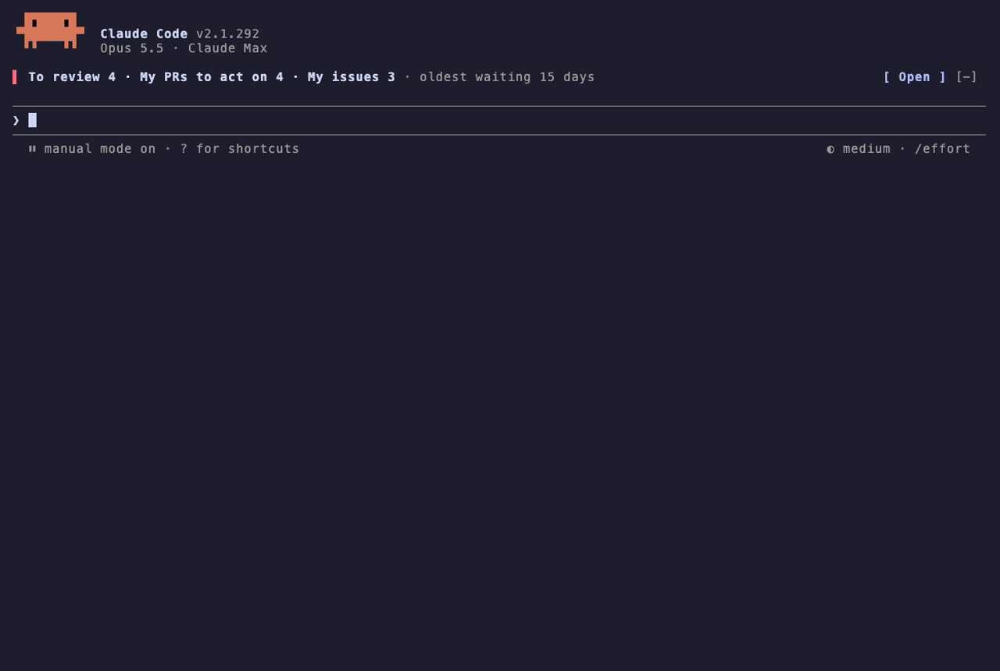
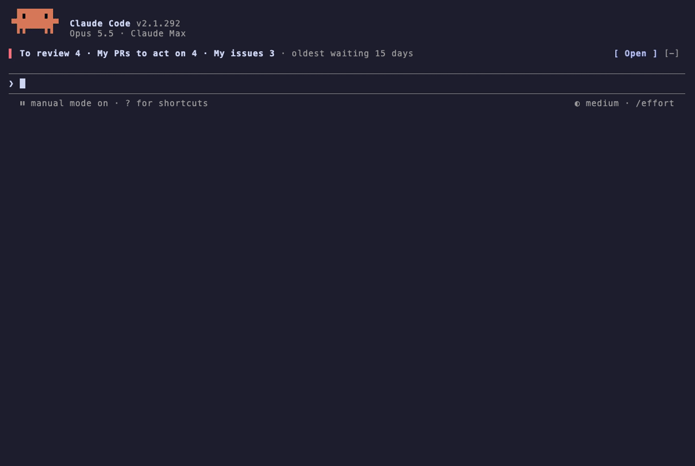
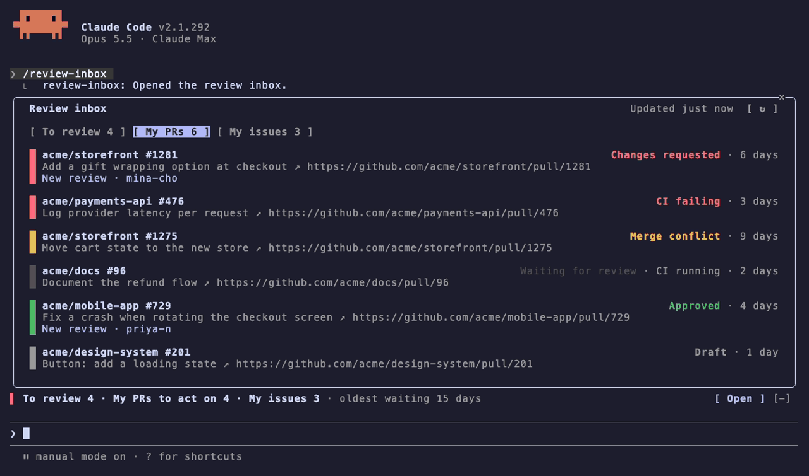
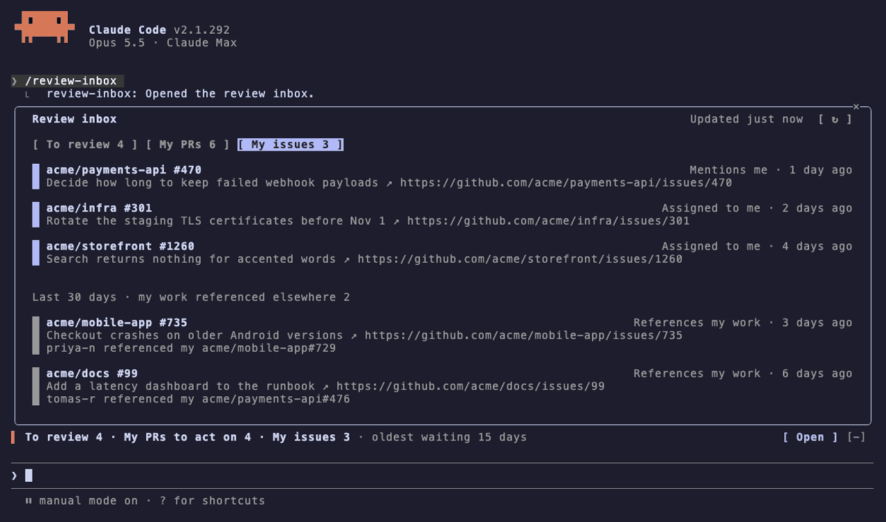
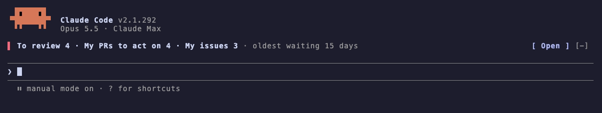

# Review Inbox

[](https://mods.aidojo.si/#SummerRiversound--review-inbox--review-inbox) [](https://github.com/hesreallyhim/awesome-claude-code)

[English](README.md) | [한국어](README.ko.md) | [日本語](README.ja.md) | [简体中文](README.zh-CN.md) | [繁體中文](README.zh-TW.md) | [Español](README.es.md) | [Português](README.pt-BR.md) | **Deutsch** | [Français](README.fr.md)

Eine Mod für [Claude Code](https://claude.com/claude-code), die Ihre GitHub-Arbeit beim Programmieren sichtbar hält: Pull Requests, die auf Ihr Review warten – jeder in verständlicher Sprache zusammengefasst, bevor Sie ihn öffnen –, Ihre eigenen offenen PRs mit den Reviews, die sie erhalten, und die Issues, in die Sie einbezogen werden.



## Schnellstart

Mit angemeldeter [GitHub CLI](https://cli.github.com/) (`gh auth login`) im Prompt einer Claude-Code-Sitzung:

```text
/plugin marketplace add https://github.com/SummerRiversound/review-inbox.git
/plugin install review-inbox@review-inbox
/review-inbox
```

Die letzte Zeile öffnet das Panel. Optionen und Updates stehen unter [Installation](#installation).

- **Leiste über dem Prompt** – eine Zeile, die nur zählt, was Ihr Zutun erfordert: PRs, die auf Ihr Review warten, Ihre PRs, bei denen etwas zu tun ist, und Issues, die Ihnen zugewiesen sind oder Sie erwähnen. Ihre Farbe zeigt, wie lange die älteste Review-Anfrage schon wartet (gelb ab 3 Tagen, rot ab 14). `Öffnen` öffnet das Panel. Sinkt eine Zahl, wird sie kurz grün. Bei eingeschaltetem automatischem Review folgt `automatisch geprüft N` auf die Zahlen, solange Reviews, die es für Sie veröffentlicht hat, im Panel warten.
- **Panel „Review-Posteingang“** – `/review-inbox`, mit fünf Tabs: Zu reviewen, Meine PRs und Zugewiesen & erwähnt zeigen, was Sie erledigen müssen; Gespeicherte Suchen und Benachrichtigungen sind zum Stöbern da. Drücken Sie 1 bis 5, solange das Panel den Fokus hat, um von links gezählt zu diesem Tab zu wechseln. Die Zahl am Tab zählt seine Karten; Gespeicherte Suchen hat keine, und Benachrichtigungen zählt die ungelesenen.
- **Benachrichtigungen** – ein kurzer Hinweis, wenn während der Arbeit etwas Neues eintrifft.

Oberfläche und Zusammenfassungen gibt es in neun Sprachen; siehe [Sprache](#sprache).

## Voraussetzungen

- Claude Code 2.1.287 oder neuer, die ersten Builds mit Mods (Function-Hook-Plugins). Getestet mit 2.1.292. Mods befinden sich im Early Access, und ihre API kann sich zwischen Releases ändern.
- [GitHub CLI](https://cli.github.com/) (`gh`) im `PATH`, angemeldet (`gh auth login`) und mit Zugriff auf die Repositories, die Sie reviewen.
- GitHub Enterprise Server: Setzen Sie `GH_HOST` in der Umgebung, in der Claude Code startet; jeder `gh`-Aufruf geht dann an diesen Host.

## Installation

Im Prompt einer Sitzung von Claude Code:

```text
/plugin marketplace add https://github.com/SummerRiversound/review-inbox.git
/plugin install review-inbox@review-inbox
```

Der Installationsbildschirm fragt die unten beschriebenen Optionen ab; alle können leer bleiben oder ihren Standardwert behalten.

### Aktualisieren und deinstallieren

```sh
claude plugin marketplace update review-inbox
claude plugin update review-inbox@review-inbox
claude plugin uninstall review-inbox@review-inbox
```

Ein Update wird nach einem Neustart wirksam. Beim Deinstallieren bleibt der Cache-Ordner der Mod, `~/.claude/plugins/data/review-inbox`, erhalten; löschen Sie ihn selbst, um die zwischengespeicherten Listen und Zusammenfassungen zu entfernen. Was sich in den einzelnen Versionen geändert hat, steht im [Changelog](CHANGELOG.md).

## Konfiguration

Die Optionen werden auf dem Installationsbildschirm gesetzt und lassen sich später in `/config` ändern. Eine Änderung gilt sofort.

| Option | Standard | Beschreibung |
| --- | --- | --- |
| `scope` | leer | GitHub-Suchqualifizierer, die an jede Suche angehängt werden (`review-requested:@me`, `author:@me`, `assignee:@me`, `mentions:@me`). Leer bedeutet: ganz GitHub. |
| `githubUser` | leer | Das `gh`-Konto, das verwendet wird, wenn mehrere angemeldet sind (`gh auth token -u <user>`). Leer verwendet das aktive Konto. |
| `language` | `auto` | `auto` oder einer der Codes unter [Sprache](#sprache). |
| `refreshMinutes` | `10` | Minuten zwischen zwei Abrufen von GitHub: 5, 10, 15, 30 oder 60. Alle Sitzungen teilen sich einen Abruf. |
| `repoPaths` | leer | Wo Claude für die Schaltflächen zum nächsten Schritt an jedem Repository arbeitet. Siehe unten. |
| `motion` | `auto` | `off` schaltet das Aufleuchten der Zahlen in der Leiste ab. `auto` schaltet es ebenfalls ab, wenn die Einstellung für reduzierte Bewegung von Claude Code (`prefersReducedMotion`) an ist. |
| `directActions` | `off` | `on` fügt Schaltflächen hinzu, die von einer Karte aus auf GitHub schreiben. Siehe „Direkte GitHub-Aktionen“ unten. |
| `autoReview` | `off` | `on` reviewt PRs, die Sie anfragen, im Hintergrund und hält jedes Review als Ihr ausstehendes Review bereit, bis Sie es posten. **Es verbraucht deutlich mehr Tokens.** Das ist nur der Ausgangswert: Sobald Sie die Schaltfläche `Automatisches Review` oben im Tab Zu reviewen drücken, die vor dem Einschalten nachfragt, schaltet nur noch sie es ein und aus. Siehe „Automatisches Review“ unten. |
| `autoReviewPost` | `pending` | Was aus einem fertigen Review wird: `pending` behält es als Ihr ausstehendes Review, das Sie von der Karte aus veröffentlichen, `comment` veröffentlicht es als Kommentar, `verdict` mit dem vorgeschlagenen Urteil, Genehmigen und Änderungen anfordern eingeschlossen. Alles außer `pending` veröffentlicht ohne Rückfrage unter Ihrem Namen. |
| `autoReviewModel` | `sonnet` | Das Modell, auf dem der Reviewer läuft: `sonnet` oder `opus`, das gründlicher reviewt und mehr kostet. |
| `autoReviewVerify` | `off` | Mit `on` prüft ein zweiter Reviewer jeden Befund des Entwurfs am Code, bevor er gespeichert wird: Was nicht hält, fällt weg, was übertrieben ist, wird herabgestuft. Ein Review mit Befunden kostet dann etwa doppelt so viele Tokens. |
| `autoReviewDaily` | `5` | Höchstzahl automatischer Reviews, die pro Tag starten: 3, 5, 10, 20 oder `unlimited`. `Erneut versuchen` auf einer Karte wird nicht mitgezählt. |
| `autoReviewSettleMinutes` | `30` | Minuten nach dem letzten Commit eines PRs, bevor das automatische Review startet, weil Autoren direkt nach der Anfrage oft noch einmal pushen: 0, 10, 30, 60 oder 120. `0` startet sofort. |
| `autoReviewSkills` | leer | Skills, die in den Reviewer geladen werden, durch Kommas getrennt, etwa Ihr Review-Playbook. Leer lädt keine. |
| `autoReviewInstructions` | leer | Ihre eigenen Worte an den Reviewer, etwa was er zuerst prüfen oder wie er Kommentare formulieren soll. Leer fügt nichts hinzu. |
| `autoReviewSeverityNames` | leer | Wie die vier Schweregrade in einem Review heißen, von blocker bis nit, durch Kommas getrennt, etwa `Blocker, Zu entscheiden, Nachbesserung, nit`. Leer nimmt die Namen der Sprache. |
| `autoReviewLarge` | `on` | `on` reviewt auch PRs mit mehr als 50 Dateien oder 2.000 geänderten Zeilen, die deutlich mehr Tokens kosten. `off` lässt sie aus. |
| `autoReviewMaxTurns` | `40` | Wie viele Runden der Reviewer nehmen darf, bevor er antworten muss: `40`, `60`, `80` oder `120`. Ein großer PR kann mehr brauchen; ein Review, dem die Runden ausgehen, schlägt fehl, und seine Karte sagt das. |
| `autoReviewTools` | `read` | Was der Reviewer benutzen darf. `read` beschränkt ihn auf das Lesen von Diff und Code. `all` gibt ihm jedes Werkzeug Ihrer Sitzung mit deren Berechtigungen, wie wenn Sie selbst um ein Review bitten: Er kann Tests und Befehle ausführen, Beschreibung, Kommentare und Checks des PRs lesen und andere Repositorys öffnen, doch der Text eines PRs kann dann versuchen, diese Befehle zu lenken. |
| `autoReviewBacklog` | `on` | `on` reviewt auch Anfragen von vor dem Einschalten, einige pro Tag, soweit `autoReviewDaily` es erlaubt. `off` lässt sie aus. |

`scope` akzeptiert alles, was die [Issue- und PR-Suche](https://docs.github.com/en/search-github/searching-on-github/searching-issues-and-pull-requests) von GitHub akzeptiert:

```text
org:my-org
org:my-org org:other-org
repo:owner/name repo:owner/other
org:my-org -repo:my-org/noisy-repo
user:my-username
```

Wiederholte Qualifizierer `org:`, `repo:` und `user:` treffen zu, sobald einer von ihnen passt. Eine Team-Review-Anfrage zählt als Anfrage an Sie, so wie GitHubs `review-requested:@me` es definiert.

`repoPaths` nimmt durch Kommas getrennte Einträge `owner/repo=Pfad`. `owner/*=Pfad/*` gilt für alle Repositorys eines Owners, wobei `*` im Pfad für den Namen des Repositorys steht; ein genauer Name hat Vorrang vor einem Platzhalter, und `~` ist Ihr Home-Ordner. Ein hier genannter Ordner hat Vorrang vor dem Ordner der Sitzung und den Ordnern, die sich die Mod gemerkt hat.

```text
my-org/*=~/code/*
my-org/legacy=~/old/legacy-app
```

## Tabs

Jeder Tab fasst seine Karten nach Kategorien zusammen. Ein Druck auf die Überschrift einer Kategorie klappt sie zu, ein weiterer klappt sie auf. `N ausgeblendet · alle anzeigen` oben im Tab zeigt nur die ausgeblendeten Karten dieses Tabs wieder an.

`Notiz` unter `▸ Aktionen` einer Karte schreibt eine Zeile über ihren Titel: was Sie geprüft haben oder was Sie wann vorhaben. `Speichern` lässt die Karte sichtbar. `Bis morgen zurückstellen` und `Bis nächste Woche zurückstellen` blenden sie bis morgen oder nächsten Montag um 9 Uhr aus, oder früher, wenn es Neues gibt: einen neuen Commit in einer Review-Anfrage, einen neuen Zustand oder ein neues Review auf Ihrem PR, neue Aktivität in einem Issue. Eine Benachrichtigung meldet die zurückgekehrte Karte mit ihrer Notiz. `Löschen` entfernt die Notiz.

Das Suchfeld oben durchsucht alle Tabs auf einmal: Repository, Nummer, Titel, Autor, die ersten 2.000 Zeichen der Beschreibung, die Zusammenfassung und Ihre Notizen. Ausgeblendete und zurückgestellte Karten werden ebenfalls gefunden und als `ausgeblendet` markiert. Leeren Sie das Feld, um zu den Tabs zurückzukehren. Die mobile Claude-App zeichnet noch keine Textfelder; dort werden Notizen angezeigt, aber Suche und `Notiz` fehlen.

Karten, an denen eine Sitzung arbeitet, sammeln sich oben in Zu reviewen und Meine PRs unter `In Arbeit in einer Sitzung`, mit dem Ordnernamen der Sitzung oder `diese Sitzung`. Ihr PR landet dort, wenn der Ordner einer Sitzung seinen Branch in seinem Repository ausgecheckt hat; jede Karte landet dort, sobald ein Prompt dieser Sitzung auf sie verlinkt, wie es `Mit Claude reviewen` tut. Wird eine Sitzung geschlossen oder meldet sie sich 10 Minuten lang nicht, kehren ihre Karten in ihre Gruppen zurück.

Eine Sitzung, die noch eine ältere Version des Mods ausführt, etwa eine vor dem Update geöffnete und nie neu geladene, wird unter dem Titel des Fensters genannt, zum Beispiel `2 Sitzungen mit älterer Version (dhub2): dort /reload-plugins ausführen`. Eine solche Sitzung hält ihre Listen in einer eigenen Datei und zeigt ihre Listen oder Fehler deshalb nie in einer aktuellen Sitzung. `Alle neu laden` daneben bittet diese Sitzungen über `reload.json` im Cache-Ordner, `/reload-plugins` selbst auszuführen: Jede tut es, sobald sie frei ist, und lädt dabei auch ihre anderen Plugins neu. Nur Sitzungen ab 0.13.0 können darauf antworten; in einer älteren muss der Befehl einmal dort ausgeführt werden.

Karten aus dem Repository dieser Sitzung stehen in jeder Gruppe vorn, markiert mit `dieses Repository`. Enthalten die Tabs auch andere Repositorys, schränken `Dieses Repository N` und `Alle N` über den Tabs sie auf dieses Repository ein oder zeigen wieder alles; die Leiste zählt immer alles. Das Repository dieser Sitzung ist wie bei `gh` das, das `GH_REPO` nennt, sonst das der GitHub-Remotes des Ordners.

Unter dem Titel zeigt eine Karte bis zu zwei Labels und wie viele es noch gibt, die Zahl der Kommentare und bei einem PR `→ Branch`, wenn er nicht auf den Standard-Branch des Repositorys zielt.

Ein `●` vor dem Repository einer Karte markiert eine, die sich geändert hat, seit Sie das Panel zuletzt geschlossen haben, so wie GitHubs eigener Posteingang markiert, was sich seit Ihrem letzten Besuch geändert hat. Vor dem ersten Schließen ist nichts markiert.

Wenn nichts Ihr Zutun erfordert (keine Review-Anfrage, kein PR mit etwas zu tun, kein Issue, das Ihnen zugewiesen ist oder Sie erwähnt), zeigt das Panel über den Tabs `✓ Nichts wartet auf Sie`, und die Leiste bleibt verborgen.

### Zu reviewen

Eine Karte pro PR, der auf Ihr Review wartet: eine Zusammenfassung in einem Satz, der Grund für den PR, seine Auswirkungen, Größe und Autor sowie die Zeit, seit der Ihr Review aussteht. Riskante Punkte wie eine Schemaänderung oder eine vorgeschriebene Deploy-Reihenfolge werden mit ⚠️ markiert.

- `Mit Claude reviewen` markiert die Karte als `Hinzugefügt` und lässt das Panel geöffnet, sodass Sie mehrere PRs auswählen können. Wenn Sie das Panel schließen (Esc oder ×), wird für jeden hinzugefügten PR eine Review-Anfrage in Ihren Prompt eingefügt, samt Warnhinweisen und den Änderungen seit Ihrem letzten Review. Gesendet wird erst, wenn Sie Enter drücken. Ein PR, für den Ihr bereits eingegebener Text schon eine Anfrage enthält, erscheint beim Öffnen des Panels als `Hinzugefügt`.
- `Ausblenden` unter `▸ Aktionen`, neben `Notiz`, blendet die Karte aus, bis der PR einen neuen Commit erhält.
- `erneut angefragt` kennzeichnet einen PR, den Sie bereits reviewt haben und der Sie erneut anfragt, mit einer kurzen Zusammenfassung der Änderungen seit Ihrem letzten Review.
- Die Karten sind in direkte Anfragen, Team-Anfragen und Entwürfe gruppiert.



Die Anfrage enthält außerdem eine Zeile, die beschreibt, wie Sie üblicherweise reviewen, damit Claude so reviewt, wie Sie es tun würden. Einmal pro Woche liest die Mod Ihre eigenen Kommentare zu bis zu 30 PRs, die Sie kürzlich reviewt haben, und lässt Claude Ihre Sprache und Ihren Ton beschreiben, worauf Sie zuerst achten und wie Sie Bitten formulieren. Liegen weniger als fünf Kommentare zum Lernen vor, geht die Anfrage ohne diese Zeile hinaus; schlägt das Lernen fehl, bleibt die letzte Beschreibung erhalten und die Mod versucht es einen Tag später erneut. Automatische Reviews, die unter Ihrem Namen veröffentlicht wurden, bleiben außen vor, sodass sie nur aus dem lernt, was Sie selbst geschrieben haben.

### Meine PRs

Ihre offenen PRs, statt mit einer Zusammenfassung mit ihrem Zustand, in der Reihenfolge, in der Sie tätig werden müssen: Änderungen angefordert, CI fehlgeschlagen, Mergekonflikt, wartet auf Review (älteste zuerst), genehmigt, in der Merge-Warteschlange, Entwurf. Läuft gerade eine CI, steht „CI läuft“ neben dem Zustand. Ein PR in einer Merge-Warteschlange zeigt `In der Merge-Warteschlange`: GitHub merged ihn, sobald die Prüfungen der Warteschlange bestehen, daher zählt die Leiste ihn nicht mit und er zeigt nie `Bereit zum Mergen`.

`Ausblenden` blendet einen PR aus, bis sich sein Zustand ändert oder jemand ihn reviewt; Ihr eigener Push allein holt ihn nicht zurück.



Ein Review, das nach Ihrem letzten Commit eingereicht wurde, erscheint als `Neues Review` mit Angabe, von wem es stammt, bis Sie erneut committen. Das umfasst Genehmigungen, Änderungsanforderungen und reine Kommentar-Reviews einschließlich Antworten in Threads, von Menschen wie von Bots; ein verworfenes (dismissed) Review zählt nicht. Ein solcher PR zählt als zu bearbeiten und steht vor PRs ohne Neuigkeiten im selben Zustand. Es wird kein Modell aufgerufen.

Ein PR, der auf Sie wartet (Änderungen angefordert, CI fehlgeschlagen oder Merge-Konflikt), hat eine Schaltfläche für den nächsten Schritt: `Kommentare umsetzen`, `CI reparieren` oder `Konflikt lösen`. Daneben steht der Ordner, in dem Claude arbeiten würde: `dieser Ordner`, wenn diese Sitzung in einem Klon des Repositorys läuft, der Ordner der letzten Sitzung, die darin lief, oder `kein lokaler Klon`. Die Schaltfläche fügt die Karte hinzu wie `Mit Claude reviewen`. Wenn Sie das Panel schließen, nennt die Anfrage den Schritt und die `gh`-Befehle, mit denen sich die Kommentare oder die fehlgeschlagenen Logs lesen lassen, und bittet Claude, in einem neuen Worktree zu arbeiten und den Branch des Ordners nicht anzufassen. Ist kein Ordner bekannt, fragt Claude, wo Ihr Klon liegt, oder bietet `gh repo clone` an und wartet auf Ihr Ja. Keine zusätzlichen GitHub-Aufrufe und keine Modellaufrufe.

### Zugewiesen & erwähnt

Offene Issues, die Ihnen zugewiesen sind, sowie offene Issues und PRs, die Sie erwähnen; ein Eintrag, auf den beides zutrifft, erscheint nur einmal, als „Mir zugewiesen“. Darunter stehen andere Issues und PRs aus den letzten 30 Tagen, die auf eines Ihrer Issues oder einen Ihrer PRs verwiesen haben, jeweils mit Angabe, von wem. Verweise, die Sie selbst gesetzt haben, werden ausgelassen, und nur die neuesten 20 werden angezeigt. Es wird kein Modell aufgerufen.

Die Einträge sind in zugewiesen, Erwähnungen und Verweise gruppiert. `Ausblenden` blendet einen Eintrag aus, bis es neue Aktivität darauf gibt.



Ein Ihnen zugewiesenes Issue hat eine Schaltfläche `Daran arbeiten`, die genauso funktioniert: Claude liest das Issue, plant die Änderung und beginnt auf einem neuen Branch in einem neuen Worktree.

### Gespeicherte Suchen

GitHub-Suchen, die Sie selbst benennen und speichern, jede ein Abschnitt mit ihrer Anzahl und den 20 zuletzt geänderten Treffern. Ein Titel öffnet diesen PR oder dieses Issue auf GitHub, und `N weitere auf GitHub` öffnet dort die ganze Suche. Drei sind eingebaut, wie im PR-Posteingang von GitHub: `Betrifft mich` (offene PRs, an denen Sie beteiligt sind, die Sie aber nicht eröffnet haben), `Von mir reviewt, noch offen` und `Meine offenen Issues`. Ein Klick auf die Überschrift eines Abschnitts klappt ihn ein. Die Suchen laufen bei jeder Aktualisierung, drei gleichzeitig; eine, die fehlschlägt, zeigt den Grund und lässt die anderen unberührt. Keine Modellaufrufe.

Eigene gespeicherte Suchen tragen Sie unter `groups` in dieselbe `actions.json` ein wie die Kartenschaltflächen; `/review-inbox add-search` bittet Claude, eine mit Ihnen zu schreiben.

```json
{
  "groups": [
    { "id": "team", "name": "Team-PRs", "query": "org:acme is:open label:urgent", "scope": "prs", "countInBand": true },
    { "id": "reviewed-by-me", "hidden": true }
  ]
}
```

`query` ist GitHub-Suchsyntax. `scope` ist `prs` oder `issues`: Es fügt `is:pr` bzw. `is:issue` hinzu, sofern die Suche die Art nicht schon nennt, und `sort:updated-desc` wird ergänzt, sofern sie kein eigenes `sort:` hat. Die Einstellung `scope` und `Dieses Repository` schränken diese Suchen nicht ein; schreiben Sie dafür `org:` oder `repo:` in die Suche. `"countInBand": true` zählt die Anzahl der Suche als `Gespeicherte Suchen N` in der Leiste mit. Eine gespeicherte Suche mit einer eingebauten id ersetzt diese, und `"hidden": true` entfernt sie. Ein Eintrag mit fehlendem Feld oder unbekanntem scope wird ausgelassen; das Panel warnt unten davor, und `/review-inbox buttons` führt ihn mit dem Grund auf. Nur die ersten 15 gespeicherten Suchen werden ausgeführt.

### Benachrichtigungen

Ihre GitHub-Benachrichtigungen, die kein anderer Tab schon zeigt, in einem Abschnitt pro Grund (`Kommentar`, `Status geändert`, `CI-Lauf` und so weiter), darin die neuesten zuerst; ein Klick auf die Überschrift eines Abschnitts klappt ihn ein. Das sind Kommentare, Statusänderungen und neue Aktivität in Threads, die Sie eröffnet haben oder an denen Sie beteiligt sind, Team-Erwähnungen und Sicherheitswarnungen. Abgeschlossene GitHub-Actions-Läufe, die Sie gestartet haben, erscheinen auch, als `CI-Lauf`, verlinkt mit der Actions-Seite des Repositorys; GitHub sendet sie nur, solange Actions-Benachrichtigungen für GitHub aktiviert sind, unter Notifications → System → Actions in Ihren GitHub-Einstellungen. Review-Anfragen, Zuweisungen und Erwähnungen fehlen hier, ebenso Threads, deren PR oder Issue schon eine Karte ist. Ein ungelesener Thread ist mit `●` markiert, und die Zahl am Tab zählt sie. Gelesen werden bis zu 100 Benachrichtigungen der letzten 30 Tage.

`Erledigt` und `Abbestellen` nehmen die Zeile sofort weg und lassen 10 Sekunden lang `Erledigt · Rückgängig` bzw. `Abbestellt · Rückgängig` an ihrer Stelle; schließen Sie das Panel vorher, werden sie sofort abgeschickt. Dann markiert `Erledigt` den Thread auf GitHub als erledigt, wie GitHubs eigener Posteingang, und `Abbestellen` stellt außerdem seine Benachrichtigungen ab, bis Sie jemand erwähnt oder Sie kommentieren. Ein erledigter Thread kommt bei neuer Aktivität zurück. Schlägt etwas fehl, kehrt die Zeile mit dem Grund zurück. Keine Modellaufrufe.

GitHub gibt Benachrichtigungen nur an die Anmeldung von gh und an klassische Tokens. Ohne Zugriff sagt der Tab das und wie Sie ihn bekommen (`gh auth login` oder `gh auth refresh -s notifications`).

### Benachrichtigungen

Benachrichtigt wird bei einer neuen Review-Anfrage, einem neuen Review zu einem Ihrer PRs, wenn einer Ihrer PRs zu „Änderungen angefordert“, „CI fehlgeschlagen“ oder „Mergekonflikt“ wechselt, sowie bei einer neuen Zuweisung, Erwähnung oder einem neuen Verweis. Eine neue Sitzung meldet sie nicht einzeln: Eine Benachrichtigung fasst zusammen, was sich seit dem letzten Blick einer Sitzung geändert hat, etwa `Während Sie weg waren · CI fehlgeschlagen 2`, und bleibt aus, wenn sich nichts geändert hat. Bei eingeschaltetem automatischem Review gibt es auch eine Benachrichtigung, wenn ein Review fertig ist oder für Sie veröffentlicht wurde. Treffen mehrere gleichzeitig ein, erscheinen sie nacheinander im Abstand von viereinhalb Sekunden.

Wird Ihr PR genehmigt und läuft keine CI mehr, erscheint einmal `Bereit zum Mergen`.



### Schaltflächen auf Karten

`▸ Aktionen` auf einer Karte öffnet `Notiz` und `Ausblenden`, danach Schaltflächen, die die Karte jeweils mit einer vorbereiteten Anfrage an Claude übergeben: `Risiken zusammenfassen`, `Diff erklären` und `Freigabe-Kommentar entwerfen` bei einer Review-Anfrage, `Antwort an Reviewer entwerfen` und `CI-Fehler untersuchen` bei Ihrem PR. Eine Schaltfläche fügt die Karte hinzu wie `Mit Claude reviewen`, und die Anfrage landet in Ihrem Prompt, wenn Sie das Panel schließen. Bis Sie Enter drücken, wird nichts ausgeführt und nichts gepostet.

Eigene Schaltflächen legen Sie in `actions.json` im Cache-Ordner an. `/review-inbox buttons` zeigt den Pfad, den Inhalt und ausgelassene Einträge, und `/review-inbox add-button` bittet Claude, mit Ihnen eine zu schreiben.

```json
{
  "buttons": [
    { "id": "test-plan", "name": "Testplan", "scope": "review", "prompt": "Schreibe in {{.RepoPath}} einen Testplan für {{.PrUrl}}." },
    { "id": "draft-approval", "scope": "review", "hidden": true }
  ]
}
```

`scope` ist `review`, `pr` oder `issue`. Der Prompt kann `RepoName`, `RepoPath`, `PrNumber`, `PrUrl`, `PrTitle`, `Author`, `HeadRefName`, `BaseRefName`, `IssueNumber`, `IssueTitle`, `IssueUrl` verwenden, geschrieben wie in gh-dash als `{{.Name}}`, `{{Name}}`, `{{ .Name }}`; eine Variable, für die die Karte keinen Wert hat, bleibt leer. Eine Schaltfläche mit der id einer eingebauten ersetzt diese, und `"hidden": true` entfernt sie. Ein Eintrag mit fehlendem Feld, unbekanntem scope oder unbekannter Variable wird ausgelassen; das Panel warnt unten davor, und `/review-inbox buttons` führt ihn mit dem Grund auf. Der Rest funktioniert weiter. `PrTitle` und `Author` kommen so von GitHub, wie sie dort stehen; ein Prompt, der sie verwendet, gibt also Text anderer Leute an Claude weiter.

### Direkte GitHub-Aktionen

Steht `directActions` auf `on`, bekommen Karten zusätzlich Schaltflächen, die selbst auf GitHub schreiben, mit Ihrem `gh`-Konto.

- `Genehmigen` auf einer Review-Anfrage, `Bereit zur Prüfung` auf Ihrem Entwurfs-PR und `Branch aktualisieren` auf Ihrem PR, wenn sein Basis-Branch weitergezogen ist. Andere sehen diese Aktionen, und sie lassen sich nicht zurücknehmen; deshalb macht der erste Druck aus der Zeile einen Satz, der nennt, was als wer gesendet wird, etwa `Genehmigen: o/r#5 "Fix login" als kim — (kein Kommentar)`. `Genehmigung bestätigen` sendet ihn, ebenso `y`, solange das Panel die Tasten hat; `Abbrechen` oder zehn Sekunden bringen die Schaltflächen zurück. Der Fokus springt auf `Abbrechen`, und eine Bestätigung innerhalb von 300 ms nach dem ersten Druck wird ignoriert, sodass ein gehaltenes Enter nichts sendet.
- Eine Genehmigung hat keinen Kommentar und nennt den Commit, den Sie angesehen haben. Sind seitdem neue Commits hinzugekommen, wird sie nicht gesendet, und die Karte sagt es. `Branch aktualisieren` mergt den Basis-Branch hinein und rebased nie.
- `Fehlgeschlagene CI neu starten` auf Ihrem PR mit fehlschlagenden Prüfungen startet die fehlgeschlagenen Jobs der GitHub-Actions-Läufe auf seinem neuesten Commit neu. `Mir zuweisen` auf einem Issue, das Sie erwähnt, wird sofort gesendet, mit `Rückgängig` für zehn Sekunden.
- Ein fehlgeschlagener Schreibvorgang bleibt mit der Meldung von GitHub auf der Karte, und seine Schaltfläche kommt zurück.

Direkt gemergt wird nie. Ihr genehmigter PR ohne laufende Prüfungen bekommt eine Schaltfläche `Mergen`, auch wenn `directActions` aus ist: Sie fügt Ihrem Prompt die Bitte hinzu, die Merge-Methoden des Repositorys zu prüfen und `gh pr merge` auszuführen; Sie senden sie mit Enter, und Claude Code fragt nach der Erlaubnis.

### Automatisches Review

Steht `autoReview` auf `on`, liest Claude einen PR, der Sie direkt um ein Review bittet, im Hintergrund, sodass das Review auf der Karte wartet, wenn Sie dazukommen. Bevor Sie eine Schaltfläche drücken, sieht der Autor nur Ihre 👀-Reaktion am PR, solange das Review läuft. Das gilt, solange `autoReviewPost` auf `pending` steht, dem Standard.

> **Es verbraucht deutlich mehr Tokens.** Jedes Review startet einen Subagenten, der den Diff und den Code liest, mit Ihrer CLAUDE.md, Ihren Hooks und den Skills in `autoReviewSkills`: einige Zehntausend Tokens pro PR, mehr auf `opus`. Die Karte zeigt, was jedes Review gekostet hat, und `autoReviewDaily` begrenzt, wie viele pro Tag starten.

- **Was eines startet.** Eine Anfrage direkt an Sie (nicht an ein Team) auf einem PR, der kein Entwurf ist und nicht von einem Bot eröffnet wurde, sobald seit seinem letzten Commit, gemessen an dessen eigener Zeit, `autoReviewSettleMinutes` vergangen sind (standardmäßig 30 Minuten). Über Ihre Sitzungen hinweg läuft jeweils nur ein Review. Dieses 👀 zeigt Ihren anderen Rechnern, dass der PR vergeben ist, und sie lassen ihn aus; eines, das ein mitten im Review angehaltener Rechner hinterlassen hat, wird nach einer Stunde übernommen. Anfragen, die vor dem Einschalten gestellt wurden, und PRs mit mehr als 50 Dateien oder 2.000 geänderten Zeilen werden ebenfalls reviewt, außer `autoReviewBacklog` oder `autoReviewLarge` steht auf `off`. Die Schaltfläche `Automatisches Review` oben im Tab Zu reviewen schaltet es für alle Sitzungen ein und aus; nach dem ersten Drücken ändert `autoReview` in `/config` nichts mehr. Solange nichts fällig ist, läuft nichts: Es wird kein Modell gefragt und kein Agent gestartet.
- **Einrichtung.** Schaltet die Schaltfläche `Automatisches Review` es zum ersten Mal ein, kommt eine Einrichtungsanfrage in Ihre Eingabe: jede Einstellung des automatischen Reviews außer dem Ein und Aus, das bei der Schaltfläche bleibt, mit dem, was sie tut, welche Werte sie annimmt, ihrem Standardwert und ihrem aktuellen Wert. Mit Enter geht Claude sie einzeln mit Ihnen durch und schreibt, was Sie wählen, dorthin, wo `/config` sie speichert; sie gelten ab der nächsten Sitzung. `/review-inbox auto-review-config` fügt dieselbe Anfrage jederzeit ein.
- **Welche Sitzung sie ausführt.** Die Sitzung, in der Sie die Schaltfläche `Automatisches Review` einschalten, startet die Reviews auf diesem Rechner; die Rückfrage vor dem Einschalten sagt das. Mit `/review-inbox auto-review-here` in einer anderen Sitzung verlegen Sie sie dorthin, mit `/review-inbox auto-review-anywhere` darf jede Sitzung sie starten. Solange diese Sitzung geschlossen ist, warten PRs in der Warteschlange, und ihre Karten sagen das.
- **Was es liest.** Standardmäßig bekommt der Reviewer nur lesende Werkzeuge (`Read`, `Grep`, `Glob`) und keine Shell; mit `autoReviewTools` auf `all` bekommt er stattdessen jedes Werkzeug Ihrer Sitzung mit deren Berechtigungen und die Anweisung, vor einer Frage an den Autor selbst nachzuprüfen und nichts zu posten, zu pushen oder sonst für andere sichtbar zu ändern. Die Mod schreibt den Diff des PRs, bei einer erneuten Anfrage den Diff seit Ihrem letzten Review, in einen Lauf-Ordner; kennt sie den Ordner des Repositorys (den, den auch die Schaltflächen zum nächsten Schritt verwenden), checkt sie dort außerdem den Head-Commit als losgelösten (detached) Worktree aus, der entfernt wird, sobald das Review gespeichert ist.
- **Wie es reviewt.** Der Reviewer bekommt die eigenen Regeln des Mods fürs Reviewen und Schreiben, gleich welche Skills und Anweisungen Sie setzen. Jeden Befund prüft er vor dem Behalten noch einmal am Code, was er nicht bestätigen kann, wird zur Frage an den Autor, und er stuft Befunde danach ein, was ein Merge kosten würde: Blocker, schwer, leicht, Kleinigkeit. Er schreibt für jemanden, der den Code zum ersten Mal liest: das Urteil zuerst, ohne Begrüßung, und ein Satz zu dem, was die Änderung gut macht, nur wenn etwas heraussticht; jeder Befund ein kurzer Absatz dazu, was schiefgeht und was entschieden oder gewährleistet werden muss, während er dem Autor überlässt, wie der Code innen arbeitet und wie er zu beheben ist; keine Datei und Zeile in einem Kommentar, der schon an diesem Code steht; und nichts darüber, wie er geprüft hat. Er genehmigt, wenn nichts den Merge blockiert, auch mit leichten Befunden und Kleinigkeiten. `autoReviewInstructions` hat Vorrang vor diesen Regeln, und Ihr gelernter Review-Stil bestimmt nur den Ton.
- **Was es schreibt.** Das Ergebnis geht als Ihr **ausstehendes Review** an GitHub, das nur Sie sehen: Kommentare an den Zeilen, um die es geht, und alles außerhalb des Diffs nach Schweregrad gruppiert im Text des Reviews. Jeder Befund beginnt mit Schweregrad und Schlussfolgerung in Fettdruck, die Begründung steht in der Zeile darunter. Die Schweregrade heißen so wie in der Sprache des Mods oder wie `autoReviewSeverityNames` sie festlegt. Die Karte zeigt das vorgeschlagene Urteil, die Befunde nach Schweregrad, die wichtigsten drei und die Kosten. Diese Karten bleiben bei ihren Anfragen, wo Sie das Review veröffentlichen oder verwerfen. Steht `autoReviewPost` auf `comment` oder `verdict`, wird es gleich nach dem Speichern veröffentlicht und verlässt den Tab Zu reviewen. Danach erscheint es mit seinem Urteil in der Gruppe `Automatisches Review fertig` direkt unter der Schaltfläche `Automatisches Review`, damit ein für Sie veröffentlichtes Review nicht untergeht; `Alle bestätigen` in ihrer Zeile leert die Gruppe; lehnt GitHub das ab, bleibt es Ihr ausstehendes Review auf der Karte.
- **Posten.** `Als Kommentar posten`, `Posten und genehmigen` und `Posten und Änderungen anfordern`, die vorgeschlagene farbig hervorgehoben, fragen auf der Karte nach wie die Direkten GitHub-Aktionen und reichen dann das ausstehende Review ein. `Auf GitHub öffnen` öffnet die Dateien des PRs, wo Sie es vorher bearbeiten können. `In der Sitzung überarbeiten` tritt an die Stelle von `Mit Claude reviewen` und bittet Claude, gemeinsam mit Ihnen an diesem Review zu arbeiten und es erst einzureichen, wenn Sie sagen, mit welchem Urteil. `Verwerfen` löscht es. Diese Schaltflächen erscheinen auch ohne `directActions`.
- **Neue Commits.** Ein laufendes Review wird abgebrochen, wenn der PR einen neuen Commit erhält, geschlossen oder gemergt wird oder Sie nicht mehr anfragt. Ein Rebase, der keinen Inhalt ändert, verschiebt Ihr ausstehendes Review samt Ihren Änderungen auf den neuen Commit, ohne Claude zu fragen. Andere neue Commits lassen es, wo es ist: Die Karte sagt, dass Posten Code reviewen würde, den es nicht mehr gibt, und bietet `Erneut reviewen` an. Ein Posten wird abgelehnt, wenn sich der PR bewegt hat, seit die Karte gezeichnet wurde.
- **Fehler.** Eine Antwort, die sich nicht lesen lässt, oder ein Review, dessen Reviewer das Diff nicht lesen konnte, wird noch einmal versucht; danach zeigt die Karte den Grund mit `Erneut versuchen`. Ein Review, das Sie in der Aufgabenliste abgebrochen haben, wartet auf `Erneut versuchen`. Eines, dessen Sitzung geschlossen wurde, beginnt von vorn in der Warteschlange neu.

## Sprache

Leiste, Panel, Benachrichtigungen, die in Ihren Prompt eingefügte Review-Anfrage sowie die Zusammenfassungen, die Beschreibung Ihres Review-Stils und die automatischen Reviews, die das Modell schreibt, verwenden alle dieselbe Sprache.

| Code | Sprache |
| --- | --- |
| `en` | Englisch (English) |
| `ko` | Koreanisch (한국어) |
| `ja` | Japanisch (日本語) |
| `zh-CN` | Vereinfachtes Chinesisch (简体中文) |
| `zh-TW` | Traditionelles Chinesisch (繁體中文) |
| `es` | Spanisch (Español) |
| `pt-BR` | Brasilianisches Portugiesisch (Português do Brasil) |
| `de` | Deutsch |
| `fr` | Französisch (Français) |

- Ein Code wählt die jeweilige Sprache.
- `auto` (der Standard) folgt der `language`-Einstellung von Claude Code selbst, sofern sie eine dieser Sprachen nennt – per Code, englischem Namen oder Eigenbezeichnung (`ja-JP`, `Japanese`, `日本語`). Andernfalls folgt es der Locale des Systems (`LC_ALL`, `LC_MESSAGES`, dann `LANG`), und sonst gilt Englisch. Chinesisch wird als vereinfachtes Chinesisch gelesen, sofern es nicht als Taiwan, Hongkong, Macau oder traditionell gekennzeichnet ist (`zh-TW`, `zh-Hant`, `繁體中文`), Portugiesisch als brasilianisches Portugiesisch.

Zusammenfassungen und die Beschreibung Ihres Review-Stils werden pro Sprache zwischengespeichert; nach einem Wechsel werden daher jede Zusammenfassung und diese Beschreibung einmal neu in der neuen Sprache geschrieben. Jede andere Sprache fällt auf Englisch zurück.

Alle Sprachen außer Englisch und Koreanisch wurden mit Claude übersetzt und noch nicht von Muttersprachlern geprüft; dasselbe gilt für diese README. Korrekturen sind als Issue oder Pull Request willkommen: Jede Sprache ist eine Datei in [`hooks/locales/`](hooks/locales/), und die englische Tabelle, nach der sich alle anderen richten, steht in [`hooks/i18n.ts`](hooks/i18n.ts).

## Was die Mod liest und ausführt

Die Mod greift nur über Ihr eigenes `gh` auf GitHub zu, sendet PR-Texte an Claude, um die Zusammenfassungen zu schreiben, einmal pro Woche außerdem Ihre eigenen Review-Kommentare, um Ihren Stil zu beschreiben, und schreibt nur in ihren eigenen Cache-Ordner. Im Folgenden steht alles, worauf sie zugreift, und warum; die Liste entspricht dem, was `claude plugin validate .` für die Mod ausgibt. Bei eingeschaltetem `autoReview` bittet sie Claude außerdem, PRs zu reviewen, speichert jedes Review auf GitHub als Ihr ausstehendes Review oder veröffentlicht es, wie `autoReviewPost` es vorgibt, und fügt dem Ordner des Repositorys einen Worktree hinzu, solange ein Review läuft.

[](https://mods.aidojo.si/#SummerRiversound--review-inbox--review-inbox)

- **Führt `gh` aus**: `gh api graphql` für die Listen und einmal pro Woche für Ihre letzten Review-Kommentare; `gh api repos/<owner>/<repo>/compare/<from>...<to>` für einen erneut angefragten PR, und `gh auth token -u <githubUser>`, wenn `githubUser` gesetzt ist. Für den Tab Benachrichtigungen führt sie `gh api notifications` aus und beim Drücken von `Erledigt` oder `Abbestellen` `gh api -X DELETE notifications/threads/<id>` (beim Abbestellen vorher auch `/subscription`). Mit `directActions` auf `on` führt eine gedrückte Schaltfläche `gh api user` für den Kontonamen und `gh api repos/<owner>/<repo>/pulls/<n>` für den neuesten Commit aus, dann eines von `gh api -X POST …/pulls/<n>/reviews` (`event=APPROVE`, `commit_id`), `gh pr ready`, `gh api -X PUT …/pulls/<n>/update-branch`, `gh api …/actions/runs?head_sha=<sha>&status=failure` mit `gh api -X POST …/actions/runs/<id>/rerun-failed-jobs` oder `gh api -X POST`/`-X DELETE …/issues/<n>/assignees`. Bei eingeschaltetem `autoReview` führt sie vor und nach jedem Review `gh api …/pulls/<n>/reviews` und `…/pulls/<n>/files` aus, außerdem `gh pr diff` sowie `gh api -X POST …/pulls/<n>/reviews` mit dem Review auf stdin, um es als Ihr ausstehendes Review zu speichern; um es auf einen neuen Commit zu übernehmen, liest sie `…/reviews/<id>` und `…/reviews/<id>/comments` und führt `gh api -X DELETE …/reviews/<id>` aus, bevor sie es neu anlegt. Vor und nach jedem Review setzt und entfernt sie dieses 👀 mit `gh api -i -X POST …/issues/<n>/reactions` (`content=eyes`) und `gh api -X DELETE …/issues/<n>/reactions/<id>`. Die Schaltflächen der Karte führen nach dem Lesen des Head-Commits `gh api -X POST …/reviews/<id>/events` (`event=COMMENT`, `APPROVE` oder `REQUEST_CHANGES`) oder `gh api -X DELETE …/reviews/<id>` aus. Steht `autoReviewPost` auf `comment` oder `verdict`, folgt auf das gespeicherte Review `gh api -X POST …/reviews/<id>/events` (`event=COMMENT`, `APPROVE` oder `REQUEST_CHANGES`). Weitere eigene Netzwerkaufrufe macht die Mod nicht.
- **Führt `git` aus** im Ordner der Sitzung, alle 30 Sekunden: `git branch --show-current` und `git remote -v`, um eine Sitzung auf dem Branch Ihres PRs zu finden, und `git rev-parse --path-format=absolute --git-common-dir`, um sich den Hauptordner dieses Repositorys zu merken. Bei eingeschaltetem `autoReview` und bekanntem Ordner des Repositorys führt sie dort für jedes Review `git fetch origin pull/<n>/head` und `git worktree add --detach` aus und am Ende des Reviews `git worktree remove --force`.
- **Fragt Claude** (Modell `sonnet`) nach jeder Zusammenfassung und sendet dabei Repository-Namen, Titel, Beschreibung (die ersten 12.000 Zeichen), geänderte Dateipfade (bis zu 80) und Größe eines PRs; bei einem erneut angefragten PR außerdem die erste Zeile jeder Commit-Nachricht und bis zu 60 Dateipfade seit Ihrem letzten Review. Das wird auf Ihre Nutzung von Claude Code angerechnet. Jeder PR wird pro Head-Commit und Sprache einmal zusammengefasst; eine fehlgeschlagene Zusammenfassung wird pro Commit höchstens dreimal versucht. Einmal pro Woche sendet die Mod außerdem Ihre eigenen Review-Kommentare zu bis zu 30 PRs, die Sie kürzlich reviewt haben – jeder auf 500 Zeichen gekürzt, höchstens 60 davon und insgesamt 12.000 Zeichen –, um Ihren Review-Stil zu beschreiben; bei weniger als fünf wird nichts gesendet.
- **Startet einen Subagenten** nur bei eingeschaltetem `autoReview`: jeweils einen `auto-reviewer`, auf `autoReviewModel` (bei eingeschaltetem `autoReviewVerify` dazu einen zweiten, der seine Befunde prüft), mit lesenden Werkzeugen (mit `autoReviewTools` auf `all` jedem Werkzeug Ihrer Sitzung), Ihrer CLAUDE.md, Ihren Hooks und `autoReviewSkills`. Er wird auf Ihre Nutzung von Claude Code angerechnet. Sein Agententyp steht nicht in der Liste, aus der Ihr eigenes Claude wählt. Zum Abbrechen dient `TaskStop`.
- **Schreibt Dateien** nur in ihren Cache-Ordner, `~/.claude/plugins/data/review-inbox` (ist `CLAUDE_CONFIG_DIR` gesetzt, tritt es an die Stelle von `~/.claude`). `inbox-<hash>-f<n>.json` enthält die Listen und Zusammenfassungen, `hidden-<hash>.json` die ausgeblendeten PRs, `notes-<hash>.json` Ihre Notizen und Zurückstellungen (eine Datei pro Konto und Bereich, unabhängig von der Sprache), `sessions.json` Ordner, Mod-Version, Branch, GitHub-Remotes und die PR-Links aus den Prompts jeder laufenden Sitzung (eine Datei für alle Konten), `repos.json` den Hauptordner jedes GitHub-Repositorys, in dem eine Sitzung lief (für die Schaltflächen zum nächsten Schritt) und `style-<hash>.json` die Beschreibung Ihres Review-Stils. Jede Datei wird zuerst daneben geschrieben und dann mit `mv` an ihren Platz verschoben, sodass keine Sitzung eine halb geschriebene Datei liest; wo es kein `mv` gibt, etwa unter Windows, wird sie direkt geschrieben. Dort liest sie `actions.json`, falls Sie eine angelegt haben, und schreibt sie nie. `autoreview-<hash>.json` enthält den Stand jedes PRs im automatischen Review und sein letztes Ergebnis, `runs/` die Lauf-Ordner, die am Ende eines Reviews mit `rm -rf` entfernt werden.
- **Liest Umgebungsvariablen**: `CLAUDE_CONFIG_DIR`, `HOME` und `USERPROFILE`, um diesen Ordner zu finden; `GH_REPO`, um wie `gh` das Repository dieser Sitzung zu kennen; `LC_ALL`, `LC_MESSAGES` und `LANG` nur, wenn `language` auf `auto` steht. Sie setzt keine.
- **Liest Einstellungen von Claude Code**: den Schlüssel `language` nur, wenn `language` auf `auto` steht, und den Schlüssel `prefersReducedMotion` nur, wenn `motion` auf `auto` steht.
- **Liest und befüllt Ihren Prompt** nur rund um das Panel: Beim Öffnen des Panels liest sie den bereits eingegebenen Text, um die PRs zu markieren, für die er schon eine Anfrage enthält, und beim Schließen fügt sie die Anfragen für die von Ihnen hinzugefügten PRs in neuen Zeilen nach diesem Text an.

## Funktionsweise

Alle Ihre offenen Sitzungen teilen sich einen Abruf: Eine Sitzung fragt GitHub höchstens alle 10 Minuten ab, die anderen lesen, was sie gespeichert hat.

Jede offene Sitzung von Claude Code führt die Mod aus, doch alle teilen sich eine Cache-Datei pro Konto, Scope und Sprache; dasselbe gilt für ausgeblendete PRs. Jede Sitzung liest diese Datei alle 30 Sekunden. Nur die Sitzung, die sie älter als 10 Minuten vorfindet und sich eine kurzzeitige Sperre sichert, ruft GitHub ab – zehn offene Sitzungen erzeugen also eine einzige Anfrage. Die abrufende Sitzung erneuert ihre Sperre, solange sie arbeitet; eine Sperre, die 3 Minuten lang nicht erneuert wurde, wird übernommen. Ein fehlgeschlagener Abruf behält die letzten gültigen Listen und wird nach einer Minute wiederholt. `↻` im Panel ruft sofort ab.

Eine einzige GraphQL-Suche liefert alle PRs, die auf Ihr Review warten, samt allem, was die Karten brauchen; eine weitere Anfrage mit drei Suchen füllt Meine PRs und Zugewiesen & erwähnt. Verweise stammen aus den Cross-Reference-Ereignissen der PRs und Issues, die Sie erstellt haben. GitHub aktualisiert `updatedAt` eines Eintrags nicht, wenn etwas auf ihn verweist; daher werden Einträge, an denen sich in den letzten 60 Tagen etwas getan hat, auf Verweise aus den letzten 30 Tagen geprüft, 50 Einträge pro Anfrage. Lehnt GitHub die Verweissuche ab (es gilt ein Ressourcenlimit pro Abfrage), bleiben die letzten Verweise erhalten, und die anderen Tabs werden trotzdem aktualisiert.

`refreshMinutes` ändert diese 10 Minuten.

## Einschränkungen

- Höchstens 100 PRs, die auf Ihr Review warten, in GitHubs Reihenfolge nach bester Übereinstimmung. Die anderen Tabs lesen bis zu 100 Ihrer offenen PRs, 100 zugewiesene und 100 Sie erwähnende Issues sowie Verweise aus bis zu 500 kürzlich geänderten Einträgen, jeweils mit der neuesten Aktivität zuerst. Gibt es mehr, wird die Anzahl als `100+` angezeigt. Jede Liste wird in Schritten von 25 gelesen (Verweise, deren Einträge klein sind, in Schritten von 100) und erscheint, sobald sie da ist; eine Seite, bei der GitHub in ein Timeout läuft, wird mit halber Größe erneut angefragt, sodass auch ein Konto mit vielen PRs im Zeitlimit von GitHub bleibt.
- Eine gespeicherte Suche zeigt ihre 20 zuletzt geänderten Treffer; ihre Anzahl ist GitHubs Gesamtzahl für die Suche.
- Der Tab Benachrichtigungen liest bis zu 100 Benachrichtigungen der letzten 30 Tage und fragt nicht öfter, als GitHubs Abfrageintervall erlaubt.
- Ein Verweis auf einen Eintrag, den Sie seit 60 Tagen nicht angefasst haben, wird nicht erfasst.
- `Neues Review` verschwindet bei jedem neuen Commit auf dem PR, auch bei einem, den GitHubs Schaltfläche „Update branch“ oder ein Bot erstellt hat.
- Nach einem Force-Push, der den von Ihnen reviewten Commit umgeschrieben hat, zeigt ein erneut angefragter PR keine Zeile „Seit meinem letzten Review“.
- Ihr Review-Stil wird aus den PRs gelernt, die GitHubs Suche für `reviewed-by:@me -author:@me` innerhalb von `scope` liefert; Kommentare zu PRs, die Sie selbst erstellt haben, zählen daher nicht. Kommentare in der Unterhaltung eines PRs außerhalb eines Reviews fließen nicht ein.
- `Fehlgeschlagene CI neu starten` startet nur GitHub Actions neu; Prüfungen anderer CI-Dienste starten Sie dort neu. Mehrere PRs auf einmal genehmigen und mit Kommentar genehmigen gibt es nicht.
- Das automatische Review prüft den PR so, wie er auf GitHub steht; Tests oder Builds führt es nicht aus. Ein übernommenes Review wird nur verschoben, wenn der Patch jeder Datei derselbe ist; bei einem Rebase auf eine Basis, die dieselben Dateien geändert hat, wird daher neu reviewt.
- Ein Review, das `autoReviewDaily` zurückhält, hält auch die Übernahme auf einen neuen Commit zurück. `rm -rf` gibt es nur unter POSIX; unter Windows ohne WSL bleibt ein Lauf-Ordner daher im Cache-Ordner.

## Fehlerbehebung

- **Das Panel zeigt einen `gh`-Fehler.** Führen Sie `gh auth status` aus. Sind mehrere Konten angemeldet, setzen Sie `githubUser`. Die Mod versucht es jede Minute erneut.
- **Die Leiste erscheint nicht.** Sie wird nur angezeigt, wenn etwas Ihr Zutun erfordert; Nullwerte werden ausgelassen.
- **Die Sprache ist nicht die erwartete.** Setzen Sie `language` in `/config` auf einen Sprachcode statt auf `auto`.
- **Etwas anderes.** Starten Sie Claude Code mit `claude --debug`; Zeilen dieser Mod beginnen mit `review-inbox:`.

## Entwicklung

```sh
claude plugin validate .
claude plugin test .
claude --plugin-dir .
```

`claude plugin validate` und `claude plugin test` benötigen keine Anmeldung, und die CI führt beide auf dem getesteten Build von Claude Code aus. `tsconfig.json` erweitert `.claude-plugin/types/tsconfig.json`, das Claude Code beim ersten Laden der Mod aus diesem Ordner schreibt (und `.gitignore` ausschließt); führen Sie daher `claude --plugin-dir .` einmal aus, bevor Sie mit `tsc -p .` die Typen prüfen.

## Unterstützung

Wenn Review Inbox Ihnen Zeit spart, können Sie mir [einen Kaffee spendieren](https://ko-fi.com/riversound) ☕ – das hilft, das Projekt weiterzuführen. Vielen Dank!

<a href="https://ko-fi.com/riversound"></a>

## Lizenz

[MIT](LICENSE)
