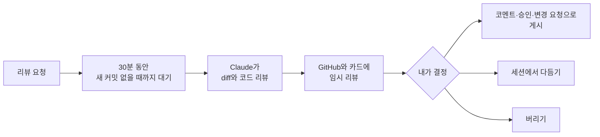

# Review Inbox

[](https://mods.aidojo.si/#SummerRiversound--review-inbox--review-inbox) [](https://github.com/hesreallyhim/awesome-claude-code)

[English](README.md) | **한국어** | [日本語](README.ja.md) | [简体中文](README.zh-CN.md) | [繁體中文](README.zh-TW.md) | [Español](README.es.md) | [Português](README.pt-BR.md) | [Deutsch](README.de.md) | [Français](README.fr.md)

[Claude Code](https://claude.com/claude-code) 안에서 보는 GitHub 받은편지함입니다. 내 리뷰를 기다리는 PR을 쉬운 말로 요약해 보여 주고, 내가 연 PR과 거기 달린 리뷰, 나를 부르는 이슈까지 세션을 떠나지 않고 확인할 수 있습니다.


## 주요 기능

| | |
| --- | --- |
| **입력창 위 한 줄** | 지금 내가 처리할 것만 셉니다. 색은 가장 오래 기다린 리뷰 요청의 경과일입니다(3일부터 노랑, 14일부터 빨강). |
| **쉬운 말 요약** | 리뷰를 기다리는 PR마다 무엇을 왜 바꾸는지, 어디에 영향을 주는지 한 문장으로 보여 주고, DB 스키마 변경 같은 위험에는 ⚠️를 붙입니다. |
| **버튼 하나로 Claude에게 넘기기** | `Claude에게 리뷰`, `CI 고치기`, `코멘트 반영` 같은 버튼이 미리 만든 요청을 입력창에 넣습니다. Enter를 누르기 전에는 아무것도 실행되지 않습니다. |
| **자동 리뷰** (선택) | Claude가 백그라운드에서 PR을 리뷰하고, 결과를 GitHub에 내 임시 리뷰로 남겨 둡니다. 게시는 내가 합니다. |
| **GitHub 알림과 저장한 검색** | 다른 탭에 없는 GitHub 알림과, 이름 붙여 저장한 검색을 각자의 탭에서 봅니다. |
| **알림** | 작업 중 리뷰 요청, 새 리뷰, CI 실패가 생기면 짧게 알립니다. |
| **9개 언어** | 화면, 요약, 리뷰 모두 같은 언어로 씁니다. |

## 빠르게 시작하기

Claude Code 2.1.287 이상과, 로그인(`gh auth login`)한 [GitHub CLI](https://cli.github.com/)가 필요합니다. Claude Code 입력창에 차례로 입력합니다.

```text
/plugin marketplace add https://github.com/SummerRiversound/review-inbox.git
/plugin install review-inbox@review-inbox
/review-inbox
```

마지막 줄이 목록 창을 엽니다. 옵션은 모두 기본값으로 두어도 됩니다. 자세한 내용은 [설정](#설정)에 있습니다.

<details>
<summary>요구 사항, 업데이트와 삭제</summary>

- Claude Code 2.1.287 이상(mod를 지원하는 첫 빌드). 2.1.292에서 검증하였습니다. mod는 early access 단계라 릴리스 사이에 API가 바뀔 수 있습니다.
- `gh`가 `PATH`에 있고, 리뷰하는 저장소에 접근할 수 있어야 합니다. GitHub Enterprise Server를 쓰면 Claude Code를 실행하는 환경에 `GH_HOST`를 설정하십시오.

```sh
claude plugin marketplace update review-inbox
claude plugin update review-inbox@review-inbox
claude plugin uninstall review-inbox@review-inbox
```

업데이트는 재시작 후에 적용됩니다. 삭제해도 캐시 폴더 `~/.claude/plugins/data/review-inbox`는 남으니, 저장된 목록과 요약까지 지우려면 직접 삭제하십시오. 버전별 변경 사항은 [CHANGELOG](CHANGELOG.md)에 있습니다.

</details>

## 사용법

`/review-inbox`로 목록 창을 엽니다. `1`~`5`로 탭을 바꾸고, 검색창에 입력하면 모든 탭을 한 번에 찾으며(제목, 본문, 요약, 내 메모), 묶음 제목을 누르면 접힙니다.

| 탭 | 보여 주는 것 | 버튼 |
| --- | --- | --- |
| **리뷰 대기** | 내 리뷰를 기다리는 PR. 요약, 변경 규모, 대기 일수와 함께 보여 줍니다. 다시 요청한 PR에는 `재요청`과 지난 리뷰 이후 바뀐 점이 붙습니다. | `Claude에게 리뷰`, 새 커밋까지 `숨기기` |
| **내 PR** | 내가 연 PR을 처리할 순서대로 보여 줍니다. 변경 요청, CI 실패, 충돌, 리뷰 대기, 승인됨, 머지 큐, 초안 순입니다. 마지막 커밋 뒤에 리뷰가 달리면 `새 리뷰`가 붙습니다. | `코멘트 반영`, `CI 고치기`, `충돌 해결`, `머지` |
| **할당·언급** | 나에게 할당된 이슈, 나를 언급한 이슈·PR, 최근 내 작업을 참조한 곳. | `작업하기` |
| **저장한 검색** | `나와 관련된 PR`, `내가 리뷰했고 아직 열린 PR`, `내가 연 이슈`와 내가 추가한 검색. | GitHub에서 열기 |
| **GitHub 알림** | 다른 탭에 없는 GitHub 알림을 이유별로 보여 줍니다. 읽지 않은 알림에는 `●`가 붙습니다. | `완료`, `구독 해제` |


모든 카드의 `▸ 작업`에는 `메모`(제목 위 한 줄), `저장`, `내일까지 미루기`·`다음 주까지 미루기`와, 카드를 Claude에게 넘기는 `위험 요약`, `변경 설명`, `승인 코멘트 초안`, `리뷰어 답글 초안`, `CI 실패 조사`가 있습니다. Claude에게 넘기는 버튼을 누르면 카드에 `추가됨`이 표시되고, 목록 창을 닫을 때 요청이 입력창에 들어갑니다. Enter를 누르기 전에는 아무것도 실행되지 않습니다.

| 내 PR | 할당·언급 |
| --- | --- |
|  |  |

<details>
<summary>카드, 세션, 알림 더 보기</summary>

- **다음 할 일 버튼.** 내가 처리할 차례인 PR이나 나에게 할당된 이슈의 버튼 옆에는 Claude가 작업할 폴더가 표시됩니다. `이 폴더`, 그 저장소에서 마지막으로 열린 세션의 폴더, 또는 `로컬 클론 없음`입니다. Claude는 새 worktree에서 작업하고 그 폴더의 브랜치는 건드리지 않습니다. 아는 폴더가 없으면 클론 위치를 묻거나 `gh repo clone`을 제안합니다.
- **내 리뷰 방식.** 리뷰 요청에는 내가 평소 리뷰하는 방식을 설명하는 한 줄이 붙습니다. 일주일에 한 번 최근 리뷰한 PR 최대 30개에서 내가 남긴 코멘트를 읽고, 언어와 어조, 먼저 보는 부분을 Claude에게 정리하게 합니다. 내 이름으로 올라간 자동 리뷰는 빼고 배웁니다.
- **세션에서 진행 중.** 세션이 작업 중인 카드는 리뷰 대기와 내 PR 탭 맨 위에 그 세션의 폴더 이름과 함께 모입니다. 내 PR은 세션이 그 브랜치에 있을 때, 어떤 카드든 세션의 프롬프트에 그 링크가 들어갔을 때입니다. 세션이 닫히거나 10분 동안 소식이 없으면 원래 묶음으로 돌아갑니다.
- **이 저장소 먼저.** 이 세션이 열린 저장소의 카드는 맨 위에 오고 `이 저장소` 표시가 붙습니다. 탭 위의 `이 저장소 N`과 `전체 N`으로 범위를 좁히거나 넓힐 수 있고, 입력창 위 한 줄은 언제나 전체를 셉니다.
- **숨기거나 미룬 카드**는 새 소식이 생기면 돌아옵니다. 리뷰 요청 PR의 새 커밋, 내 PR의 상태 변화나 새 리뷰, 이슈의 새 활동입니다. `숨김 N · 모두 보이기`로 직접 다시 볼 수도 있습니다.
- **마지막으로 본 뒤 갱신됨.** 카드의 저장소 앞 `●`는 목록 창을 마지막으로 닫은 뒤 갱신된 카드입니다.
- **알림**은 새 리뷰 요청, 내 PR의 새 리뷰, 내 PR이 변경 요청·CI 실패·충돌로 바뀐 경우, 새 할당·언급·참조가 생긴 경우에 뜹니다. 새 세션에서는 자리를 비운 사이 바뀐 것을 한 번에 묶어 알립니다. 내 PR이 승인되고 돌고 있는 CI가 없으면 `머지 준비 완료`를 한 번 알립니다.
- **옛 버전 세션.** 옛 버전 mod를 돌리는 세션이 있으면 목록 창 제목 아래에 알려 줍니다. `모두 다시 불러오기`를 누르면 그 세션들이 한가해질 때 `/reload-plugins`를 실행합니다(0.13.0 이후).
- **GitHub 알림**은 gh 로그인이나 classic 토큰에만 옵니다(`gh auth refresh -s notifications`). `완료`와 `구독 해제`는 10초 동안 `되돌리기`를 보여 줍니다. 끝난 Actions 실행은 GitHub 설정에서 Actions 알림을 켜 둔 동안에만 `CI 실행`으로 들어옵니다.


</details>

## 자동 리뷰

리뷰 대기 탭 맨 위의 `자동 리뷰` 버튼으로 켭니다. 켜기 전에 비용을 알려 주고 확인을 받습니다. 켜면 나에게 직접 리뷰를 요청한 PR을 Claude가 백그라운드에서 리뷰하고, 그 결과는 게시하기 전까지 나만 볼 수 있는 **임시 리뷰**로 카드에서 기다립니다.



> **토큰을 눈에 띄게 더 씁니다.** PR 하나에 수만 토큰이 들고 `opus`에서는 더 듭니다. 카드에 리뷰마다 든 비용이 표시되고, `autoReviewDaily`가 하루에 시작하는 개수를 제한합니다(기본 5개).

- **리뷰 대상.** 나에게 직접 온 요청이면서 초안이 아니고 봇이 열지 않은 PR입니다. 리뷰가 도는 동안 작성자에게는 내 👀 반응만 보입니다.
- **리뷰어가 받는 것.** diff, 저장소 폴더를 알면 head 커밋의 코드, PR 본문·코멘트·CI 결과, 카드 요약이 짚은 위험, 같은 owner의 다른 저장소 폴더 위치입니다. 기본으로는 읽기만 하고, `autoReviewTools`를 `all`로 두면 내 세션의 모든 도구를 받아 테스트와 명령도 실행합니다.
- **`all`일 때의 권한.** 리뷰어는 백그라운드에서 내 세션의 권한 그대로 일합니다. 세션이 실행 전에 물어보는 명령은 내가 자리에 없는 동안 실행되지 않을 수 있으니, 테스트처럼 리뷰에 필요한 명령을 허용하는 권한 모드나 허용 규칙을 둔 세션에서 자동 리뷰를 돌리십시오.
- **쓰는 방식.** 판정을 먼저 쓰고, 지적은 블로커·메이저·마이너·nit로 등급을 매겨 굵은 결론과 그 아래 이유로 씁니다. 지적은 해당하는 줄에 달립니다. 학습한 내 리뷰 스타일은 말투에만 쓰이고, `autoReviewInstructions`가 기본 규칙보다 우선합니다.
- **카드에서.** 제안한 판정, 심각도별 지적, 비용과 함께 `코멘트로 게시`, `게시하고 승인`, `게시하고 변경 요청`, `GitHub에서 열기`, `세션에서 다듬기`, `버리기` 버튼이 나옵니다.

<details>
<summary>설정 도우미, 세션, 새 커밋, 실패</summary>

- **설정.** `자동 리뷰` 버튼 옆의 `설정 ▸`를 누르면 그 아래에 자동 리뷰 설정이 펼쳐집니다. 값을 고르거나 입력하면 `/config`에서 바꿀 때처럼 바로 적용됩니다. 버튼으로 처음 켤 때는 저절로 펼쳐집니다. 거기 있는 `Claude와 같이 정하기`나 언제든 `/review-inbox auto-review-config`를 쓰면 입력창에 한 줄이 들어가고, Enter를 누르면 Claude가 설정을 하나씩 함께 정합니다. 한 번 누른 뒤에는 버튼만 모든 세션의 자동 리뷰를 켜고 끄며, `/config`의 `autoReview`는 처음 상태일 뿐입니다.
- **리뷰를 돌리는 세션.** 버튼을 켠 세션이 이 기기의 리뷰를 시작합니다. `/review-inbox auto-review-here`로 다른 세션으로 옮기고, `/review-inbox auto-review-anywhere`로 아무 세션에서나 돌리게 할 수 있습니다. 내 모든 세션과 기기를 통틀어 리뷰는 한 번에 하나만 돌고, 👀를 보고 다른 기기는 그 PR을 건너뜁니다. 리뷰 도중 멈춘 기기가 남긴 👀는 한 시간 뒤 다른 기기가 넘겨받습니다.
- **실행 폴더.** mod가 diff(재요청이면 지난 리뷰 이후의 diff도), PR 본문, 대화, 줄 코멘트, CI 결과를 실행 폴더에 쓰고, 저장소 폴더를 알면 head 커밋을 거기에 detached worktree로 체크아웃합니다. 리뷰를 저장하면 둘 다 지웁니다.
- **기본 규칙.** 리뷰어는 지적마다 코드를 다시 읽어 성립하는지 확인하고, 확정하지 못한 것은 질문으로 바꾸며, 머지를 막을 것이 없으면 승인하고, 어떻게 확인했는지는 쓰지 않습니다. `autoReviewVerify`를 켜면 저장하기 전에 두 번째 리뷰어가 지적마다 다시 확인합니다.
- **대신 게시.** `autoReviewPost`가 `comment`나 `verdict`면 저장하자마자 게시하고, 버튼 아래 `자동 리뷰 완료` 묶음에 보여 줍니다. `모두 확인`으로 비웁니다. GitHub이 게시를 거부하면 임시 리뷰로 남습니다.
- **새 커밋.** 실행 중인 리뷰는 PR에 새 커밋이 오거나, PR이 닫히거나, 더는 나에게 리뷰를 요청하지 않으면 멈춥니다. 내용이 바뀌지 않는 rebase는 내 임시 리뷰를 수정 사항째 새 커밋으로 옮기고, 그 밖의 새 커밋에는 `다시 리뷰`를 제안합니다.
- **실패.** 읽을 수 없는 답은 한 번 더 시도하고, 그래도 안 되면 카드가 이유와 `다시 시도`를 보여 줍니다. 턴을 다 쓴 리뷰는 바로 실패하고 그렇게 알려 주니 `autoReviewMaxTurns`를 늘리십시오.

</details>

## 설정

설치 화면에서 정하고, 이후 `/config`에서 바꿀 수 있습니다. 바꾸면 바로 적용됩니다.

**일반**

| 옵션 | 기본값 | 역할 |
| --- | --- | --- |
| `scope` | 비어 있음 | 모든 검색에 덧붙이는 GitHub 검색 조건입니다(예: `org:my-org`). 비워 두면 GitHub 전체를 봅니다. |
| `githubUser` | 비어 있음 | 여러 계정에 로그인한 경우 쓸 `gh` 계정입니다. |
| `language` | `auto` | `auto` 또는 [언어 설정](#언어-설정)의 코드입니다. |
| `refreshMinutes` | `10` | GitHub에서 다시 가져오는 간격(분)입니다. 5, 10, 15, 30, 60 중 하나이며, 모든 세션이 한 번의 조회를 함께 씁니다. |
| `repoPaths` | 비어 있음 | 저장소마다 디스크의 위치입니다. 다음 할 일 버튼과 자동 리뷰가 씁니다. |
| `motion` | `auto` | `off`면 입력창 위 한 줄의 숫자가 깜빡이지 않습니다. `auto`는 Claude Code의 움직임 줄이기 설정을 따릅니다. |
| `directActions` | `off` | `on`이면 GitHub에 직접 쓰는 버튼을 붙입니다. [GitHub 직접 실행](#github-직접-실행)을 보십시오. |

**자동 리뷰**

| 옵션 | 기본값 | 역할 |
| --- | --- | --- |
| `autoReview` | `off` | 자동 리뷰의 처음 상태입니다. `자동 리뷰` 버튼을 한 번 누르면 그 뒤로는 버튼이 정합니다. |
| `autoReviewPost` | `pending` | `pending`은 내가 게시하도록 남겨 두고, `comment`나 `verdict`는 묻지 않고 내 이름으로 게시합니다. |
| `autoReviewModel` | `sonnet` | `sonnet`, 또는 더 깊이 리뷰하고 비용이 더 드는 `opus`입니다. |
| `autoReviewTools` | `read` | `read`면 리뷰어가 읽기만 합니다. `all`이면 내가 직접 리뷰를 시킬 때처럼 내 세션의 모든 도구를 세션 권한 그대로 받습니다. 대신 PR 글이 리뷰어가 실행할 명령을 조종하려 들 수 있습니다. |
| `autoReviewVerify` | `off` | `on`이면 두 번째 리뷰어가 지적마다 확인합니다. 토큰이 약 두 배 듭니다. |
| `autoReviewDaily` | `5` | 하루에 시작하는 리뷰의 최대 개수입니다. 3, 5, 10, 20 또는 `unlimited`입니다. |
| `autoReviewSettleMinutes` | `30` | 새 커밋 없이 이만큼 지나야 리뷰를 시작합니다(분). 0, 10, 30, 60, 120 중 하나입니다. |
| `autoReviewMaxTurns` | `40` | 리뷰어가 쓸 수 있는 턴 수입니다. 40, 60, 80, 120 중 하나입니다. |
| `autoReviewSkills` | 비어 있음 | 리뷰어에게 불러올 스킬을 쉼표로 이어 적습니다. 예: 내 리뷰 플레이북. |
| `autoReviewInstructions` | 비어 있음 | 리뷰어에게 전할 내 지침입니다. 예: 무엇부터 볼지. |
| `autoReviewSeverityNames` | 비어 있음 | blocker부터 nit까지 네 심각도 이름을 쉼표로 적습니다. 예: `블로커, 결정 필요, 보완, nit`. |
| `autoReviewLarge` | `on` | `off`면 파일 50개나 변경 2,000줄을 넘는 PR을 건너뜁니다. |
| `autoReviewBacklog` | `on` | `off`면 자동 리뷰를 켜기 전에 온 요청을 건너뜁니다. |

<details>
<summary><code>scope</code>와 <code>repoPaths</code> 예시</summary>

`scope`에는 GitHub [이슈·PR 검색](https://docs.github.com/en/search-github/searching-on-github/searching-issues-and-pull-requests)이 받는 조건을 그대로 씁니다. `org:`, `repo:`, `user:`를 여러 번 쓰면 그중 하나에 해당하는 항목을 모두 보고, 팀에 온 리뷰 요청도 나에게 온 요청으로 셉니다.

```text
org:my-org
org:my-org org:other-org
repo:owner/name repo:owner/other
org:my-org -repo:my-org/noisy-repo
```

`repoPaths`에는 `owner/repo=경로`를 쉼표로 이어 적습니다. `owner/*=경로/*`는 그 owner의 모든 저장소에 적용되고, 정확한 이름이 와일드카드보다 우선하며, `~`는 홈 폴더입니다. 여기 적은 폴더가 세션 자신의 폴더나 mod가 기억한 폴더보다 우선합니다.

```text
my-org/*=~/code/*,my-org/legacy=~/old/legacy-app
```

</details>

## 직접 바꾸기

캐시 폴더의 `actions.json`에 내 카드 버튼과 저장한 검색을 추가합니다. `/review-inbox buttons`가 파일 경로와 빠진 항목을 보여 주고, `/review-inbox add-button`과 `/review-inbox add-search`를 입력하면 Claude가 함께 만들어 줍니다.

```json
{
  "buttons": [
    { "id": "test-plan", "name": "테스트 계획", "scope": "review", "prompt": "{{.RepoPath}}에서 {{.PrUrl}}의 테스트 계획을 써 줘." },
    { "id": "draft-approval", "scope": "review", "hidden": true }
  ],
  "groups": [
    { "id": "team", "name": "팀 PR", "query": "org:acme is:open label:urgent", "scope": "prs", "countInBand": true },
    { "id": "reviewed-by-me", "hidden": true }
  ]
}
```

<details>
<summary>필드 설명</summary>

- **버튼.** `scope`는 `review`, `pr`, `issue` 중 하나입니다. prompt에는 `RepoName`, `RepoPath`, `PrNumber`, `PrUrl`, `PrTitle`, `Author`, `HeadRefName`, `BaseRefName`, `IssueNumber`, `IssueTitle`, `IssueUrl`를 gh-dash처럼 `{{.Name}}` 형태로 쓸 수 있습니다. `PrTitle`과 `Author`는 다른 사람이 쓴 글을 Claude에게 넘기게 됩니다.
- **저장한 검색.** `query`는 GitHub 검색 문법입니다. `scope`(`prs` 또는 `issues`)가 `is:pr`이나 `is:issue`를 붙이고, 검색어에 정렬이 없으면 `sort:updated-desc`도 붙입니다. `scope` 설정은 이 검색을 좁히지 않습니다. `"countInBand": true`면 개수를 입력창 위 한 줄에 더합니다. 앞의 15개만 실행하고, 검색마다 최근 갱신된 20건을 보여 줍니다.
- **공통.** 기본 항목과 같은 id를 쓰면 그 항목을 대신하고, `"hidden": true`면 없앱니다. 필드가 빠졌거나 scope나 변수 이름이 틀린 항목은 빠지고 목록 창 맨 아래에 경고가 뜹니다.

</details>

### GitHub 직접 실행

`directActions`를 `on`으로 두면 카드에 내 `gh` 계정으로 GitHub에 직접 쓰는 버튼이 더 붙습니다. 리뷰 요청의 `승인`, 내 PR의 `리뷰 준비 완료`와 `브랜치 업데이트`, `실패한 CI 다시 실행`, 나를 언급한 이슈의 `나에게 할당`입니다.

- 다른 사람에게 보이고 되돌릴 수 없는 동작이라, 처음 누르면 무엇을 어느 계정으로 보낼지 보여 줍니다. 확정 버튼(또는 `y`)을 누르면 보내고, `취소`를 누르거나 10초가 지나면 버튼이 돌아옵니다. 처음 누른 뒤 300ms 안의 확정은 무시합니다.
- 승인은 내가 본 커밋을 지정하고, 그 뒤 새 커밋이 생겼으면 보내지 않습니다. `브랜치 업데이트`는 머지하며 rebase는 하지 않습니다. `나에게 할당`은 바로 보내고 `되돌리기`를 보여 줍니다.
- 머지는 직접 하지 않습니다. `머지`는 저장소의 머지 방식을 확인하고 `gh pr merge`를 실행하라는 요청을 입력창에 넣습니다.

## 언어 설정

mod가 보여 주거나 쓰는 모든 것이 한 언어를 씁니다. `en`, `ko`, `ja`, `zh-CN`, `zh-TW`, `es`, `pt-BR`, `de`, `fr` 중 하나입니다.

`auto`(기본값)는 Claude Code의 `language` 설정, 그다음 시스템 로케일(`LC_ALL`, `LC_MESSAGES`, `LANG`), 그다음 영어 순으로 따릅니다. 언어를 바꾸면 요약을 새 언어로 한 번 더 작성합니다. 영어와 한국어를 제외한 언어는 Claude로 번역하였습니다. 번역 수정은 [`hooks/locales/`](hooks/locales/)로 제안해 주십시오.

## 개인정보와 권한

이 mod는 내 `gh`로만 GitHub에 접근하고, 요약을 위해 PR 내용을 Claude에 보내며, 자기 캐시 폴더에만 파일을 씁니다. 자동 리뷰를 켜면 서브에이전트를 시작하고 리뷰를 GitHub에 저장하는 일도 합니다.

[](https://mods.aidojo.si/#SummerRiversound--review-inbox--review-inbox)

<details>
<summary>읽고 실행하는 모든 것</summary>

아래 항목은 `claude plugin validate .`가 이 mod에 대해 보여 주는 목록과 같습니다.

- **`gh` 실행**: 목록 조회와 일주일에 한 번 최근 리뷰 코멘트 조회에 `gh api graphql`, 재요청 PR의 변경분 조회에 `gh api repos/<owner>/<repo>/compare/<from>...<to>`, `githubUser`를 설정한 경우 `gh auth token -u <githubUser>`를 실행합니다. GitHub 알림 탭에는 `gh api notifications`를, `완료`나 `구독 해제`를 누르면 `gh api -X DELETE notifications/threads/<id>`(구독 해제는 그 전에 `/subscription`도)를 실행합니다. `directActions`가 `on`일 때 버튼을 누르면 계정 이름을 위해 `gh api user`, 최신 커밋 확인을 위해 `gh api repos/<owner>/<repo>/pulls/<n>`를 실행하고, 이어서 `gh api -X POST …/pulls/<n>/reviews`(`event=APPROVE`, `commit_id`), `gh pr ready`, `gh api -X PUT …/pulls/<n>/update-branch`, `gh api …/actions/runs?head_sha=<sha>&status=failure`와 `gh api -X POST …/actions/runs/<id>/rerun-failed-jobs`, 또는 `gh api -X POST`/`-X DELETE …/issues/<n>/assignees` 중 하나를 실행합니다. `autoReview`가 `on`이면 리뷰 전후로 `gh api …/pulls/<n>/reviews`와 `…/pulls/<n>/files`, `gh pr diff`, 본문과 대화를 위한 `gh pr view`, `gh api …/pulls/<n>/comments`와 `gh api …/commits/<sha>/check-runs`를 실행하고, 리뷰를 내 임시 리뷰로 저장하려고 표준 입력으로 리뷰를 넘기며 `gh api -X POST …/pulls/<n>/reviews`를 실행합니다. 새 커밋으로 옮길 때는 `…/reviews/<id>`와 `…/reviews/<id>/comments`를 읽고, 다시 만들기 전에 `gh api -X DELETE …/reviews/<id>`를 실행합니다. 리뷰 앞뒤로 `gh api -i -X POST …/issues/<n>/reactions`(`content=eyes`)와 `gh api -X DELETE …/issues/<n>/reactions/<id>`로 그 👀를 달고 지웁니다. 카드 버튼은 head 커밋을 읽은 뒤 `gh api -X POST …/reviews/<id>/events`(`event=COMMENT`, `APPROVE` 또는 `REQUEST_CHANGES`) 또는 `gh api -X DELETE …/reviews/<id>`를 실행합니다. `autoReviewPost`가 `comment`나 `verdict`면 저장한 리뷰에 이어서 같은 호출을 실행합니다. 그 밖의 네트워크 호출은 하지 않습니다.
- **`git` 실행**: 30초마다 세션 폴더에서 `git branch --show-current`와 `git remote -v`를 실행해 내 PR 브랜치에 있는 세션을 찾고, `git rev-parse --path-format=absolute --git-common-dir`로 그 저장소의 원래 폴더를 기억합니다. `autoReview`가 `on`이고 저장소 폴더를 알면 리뷰마다 그 폴더에서 `git fetch origin pull/<n>/head`와 `git worktree add --detach`를 실행하고, 리뷰가 끝나면 `git worktree remove --force`를 실행합니다.
- **Claude 호출**(`sonnet` 모델): PR의 저장소 이름, 제목, 설명(앞 12,000자), 변경 파일 경로(최대 80개), 변경 규모를 보내 요약을 받습니다. 재요청 PR은 지난 리뷰 이후 커밋 메시지의 첫 줄과 파일 경로(최대 60개)도 보냅니다. 요약은 PR의 head 커밋과 언어마다 한 번 작성하고, 실패하면 커밋마다 최대 세 번까지 시도합니다. 또한 일주일에 한 번, 최근 내가 리뷰한 PR 최대 30개에서 내가 남긴 리뷰 코멘트를 보내 리뷰 방식을 정리합니다. 코멘트마다 500자까지 자르고 최대 60개, 합계 12,000자까지 보내며, 다섯 개보다 적으면 보내지 않습니다. Claude Code 사용량에 포함됩니다.
- **서브에이전트 시작**: `autoReview`가 `on`일 때만 합니다. `auto-reviewer` 하나를 한 번에 하나씩, `autoReviewModel`로(`autoReviewVerify`가 `on`이면 지적을 검증하는 두 번째 에이전트도 함께), 읽기 전용 도구(`autoReviewTools`가 `all`이면 내 세션의 모든 도구)와 내 CLAUDE.md, 훅, `autoReviewSkills`와 함께 실행합니다. Claude Code 사용량에 포함됩니다. 이 에이전트 종류는 내 Claude가 고르는 목록에서 빠져 있습니다. 멈출 때는 `TaskStop`을 씁니다.
- **파일 쓰기**: 캐시 폴더 `~/.claude/plugins/data/review-inbox`에만 씁니다(`CLAUDE_CONFIG_DIR`를 설정하면 `~/.claude` 대신 그 경로를 씁니다). `inbox-<hash>-f<n>.json`에 목록과 요약을, `hidden-<hash>.json`에 숨긴 PR을, `notes-<hash>.json`에 메모와 미루기를(언어와 상관없이 계정·범위마다 한 파일), `sessions.json`에 살아 있는 세션마다 폴더 이름, mod 버전, 브랜치, GitHub 원격 저장소, 프롬프트에 들어간 PR 링크를(계정과 상관없이 하나), `repos.json`에 세션이 열렸던 GitHub 저장소마다 원래 폴더를(다음 할 일 버튼이 보여 줄 폴더), `style-<hash>.json`에 리뷰 방식 설명을 저장합니다. `autoreview-<hash>.json`에는 PR마다 자동 리뷰에서의 진행 단계와 마지막 결과를, `runs/`에는 실행 폴더를 저장하며, 실행 폴더는 리뷰가 끝나면 `rm -rf`로 지웁니다. 각 파일은 옆에 임시 파일로 쓴 뒤 `mv`로 옮겨 놓으므로 다른 세션이 반쯤 쓰인 파일을 읽지 않습니다. Windows처럼 `mv`가 없으면 그 자리에 바로 씁니다. 내가 만든 `actions.json`이 있으면 그 폴더에서 읽기만 하고 쓰지는 않습니다.
- **환경 변수 읽기**: 그 폴더를 찾기 위해 `CLAUDE_CONFIG_DIR`, `HOME`, `USERPROFILE`을 읽고, `gh`처럼 이 세션의 저장소를 알기 위해 `GH_REPO`를 읽습니다. 또한 `language`가 `auto`일 때만 `LC_ALL`, `LC_MESSAGES`, `LANG`을 읽습니다. 환경 변수를 설정하지는 않습니다.
- **Claude Code 설정 읽기**: `language`가 `auto`일 때만 `language` 키를, `motion`이 `auto`일 때만 `prefersReducedMotion` 키를 읽습니다.
- **입력창 읽기·채우기**: 목록 창을 열고 닫을 때만 합니다. 열 때는 이미 요청한 PR을 표시하기 위해 작성 중인 내용을 읽고, 닫을 때는 추가한 PR의 요청 문장을 작성 중인 내용 다음 줄에 붙입니다.
- **자기 설정 바꾸기**: 내가 요청할 때만 합니다. `설정 ▸`에서 고른 값은 `/config`와 같은 방식으로 `$.config.set`으로 씁니다. Claude가 부를 수 있는 도구 두 개를 추가합니다. 자동 리뷰 설정을 읽는 `auto_review_settings`와 하나를 바꾸는 `set_auto_review_setting`이며, 목록에 없는 설정이나 값은 거절합니다.

</details>

<details>
<summary>동작 방식과 제약 사항</summary>

열려 있는 세션이 모두 조회 결과 하나를 공유합니다. 각 세션은 30초마다 공유 캐시 파일을 읽고, 파일이 `refreshMinutes`보다 오래되었을 때 짧은 선점(claim)을 얻은 세션 하나만 GitHub를 호출하므로, 세션이 열 개여도 요청은 한 번입니다. 3분 동안 갱신되지 않은 선점은 다른 세션이 넘겨받고, 조회에 실패하면 마지막 정상 목록을 유지한 채 1분 뒤 다시 시도하며, 목록 창의 `↻`는 바로 조회합니다. GraphQL 검색 한 번으로 리뷰 대기를, 검색 세 개를 묶은 요청 한 번으로 내 PR과 할당·언급을 채웁니다. 참조는 최근 60일 안에 갱신된 내 항목의 교차 참조 이벤트에서 가져옵니다.

- 내 리뷰를 기다리는 PR은 최대 100개, 다른 목록도 각각 최대 100개까지 보고, 더 많으면 `100+`로 표시합니다. 목록은 25개씩 나눠 읽고, GitHub가 시간 초과로 실패한 페이지는 절반 크기로 다시 요청합니다.
- 60일 넘게 갱신되지 않은 내 항목에 대한 참조는 놓칩니다.
- `새 리뷰`는 GitHub의 "Update branch" 버튼이나 봇이 만든 커밋을 포함해 새 커밋이 올라오면 사라집니다. 내가 리뷰한 커밋이 force-push로 다시 쓰이면 재요청 PR에 '지난 내 리뷰 이후' 줄이 없습니다.
- 리뷰 방식은 `scope` 안의 `reviewed-by:@me -author:@me`에서만 배우고, 리뷰 밖 PR 대화의 코멘트는 포함하지 않습니다.
- `실패한 CI 다시 실행`은 GitHub Actions만 다시 실행합니다. 여러 PR을 한 번에 승인하기와 코멘트를 달아 승인하기는 없습니다.
- 자동 리뷰는 `autoReviewTools`가 `all`일 때만 테스트나 빌드를 실행합니다. 옮겨 온 리뷰는 모든 파일의 patch가 같을 때만 옮기고, `autoReviewDaily`에 막힌 리뷰는 옮기는 작업도 함께 막습니다. WSL 없는 Windows에서는 실행 폴더가 캐시 폴더에 남습니다.

</details>

## 문제 해결

| 증상 | 해결 |
| --- | --- |
| 목록 창에 `gh` 오류가 표시됨 | `gh auth status`로 확인하고, 여러 계정이면 `githubUser`를 설정하십시오. mod는 1분마다 다시 시도합니다. |
| 입력창 위 한 줄이 보이지 않음 | 처리할 항목이 있을 때만 표시합니다. |
| 원하는 언어로 표시되지 않음 | `language`를 `auto` 대신 언어 코드로 지정하십시오. |
| 그 밖의 경우 | `claude --debug`로 실행하십시오. 이 mod의 로그는 `review-inbox:`로 시작합니다. |

## 개발

```sh
claude plugin validate .
claude plugin test .
claude --plugin-dir .
```

`validate`와 `test`는 로그인 없이 실행되며, CI가 검증한 Claude Code 빌드로 둘 다 실행합니다. `tsconfig.json`이 상속하는 `.claude-plugin/types/tsconfig.json`은 Claude Code가 이 폴더의 mod를 처음 읽을 때 생성하므로, `tsc -p .` 전에 `claude --plugin-dir .`를 한 번 실행하십시오.

## 후원

Review Inbox가 시간을 아껴 주었다면 [커피 한 잔](https://ko-fi.com/riversound)으로 응원해 주십시오. 감사합니다.

<a href="https://ko-fi.com/riversound"></a>

## 라이선스

[MIT](LICENSE)
