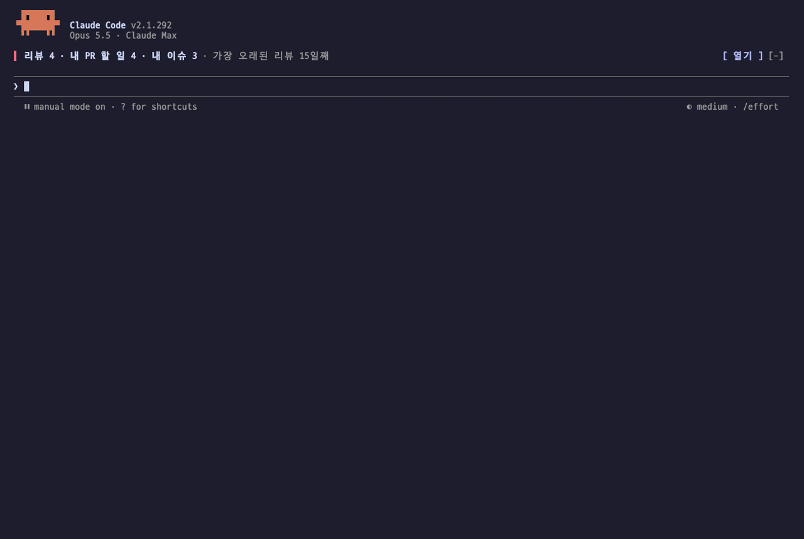
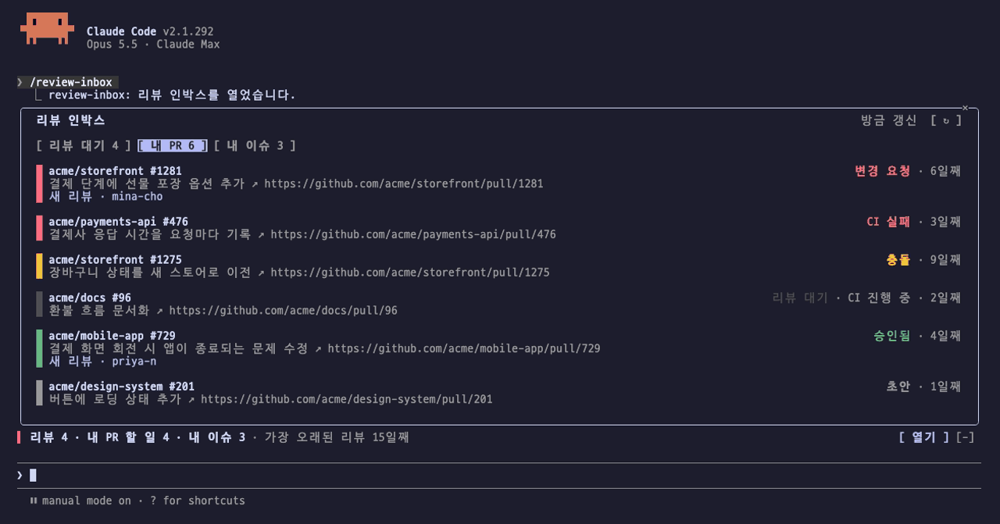
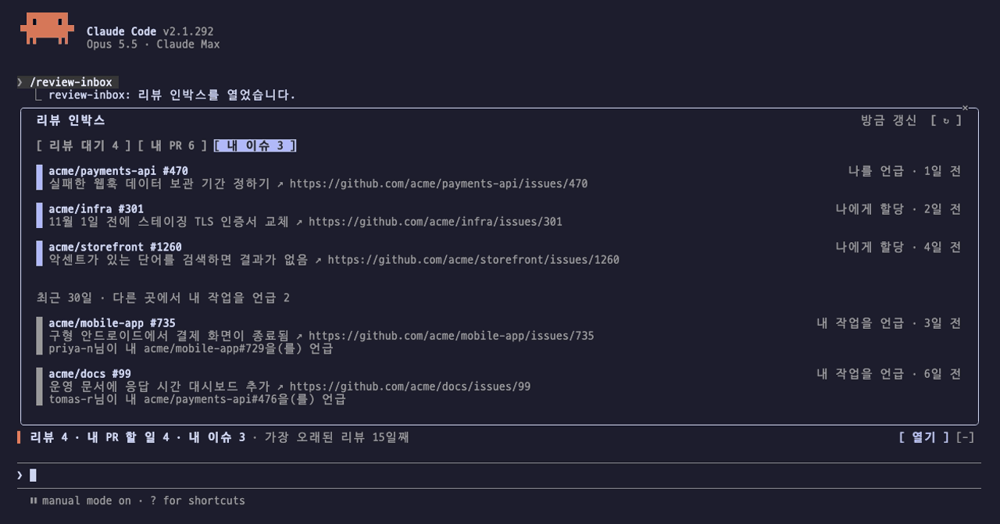
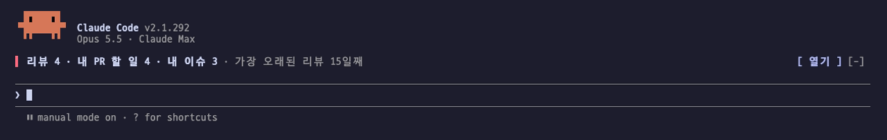

# Review Inbox

[](https://mods.aidojo.si/#SummerRiversound--review-inbox--review-inbox) [](https://github.com/hesreallyhim/awesome-claude-code)

[English](README.md) | **한국어** | [日本語](README.ja.md) | [简体中文](README.zh-CN.md) | [繁體中文](README.zh-TW.md) | [Español](README.es.md) | [Português](README.pt-BR.md) | [Deutsch](README.de.md) | [Français](README.fr.md)

내 GitHub 일을 Claude Code 안에서 보여 주는 mod입니다. 내 리뷰를 기다리는 PR은 열어 보기 전에 쉬운 말로 요약해 보여 주고, 내가 연 PR과 거기 달린 리뷰, 나를 부르는 이슈도 함께 보여 줍니다.



## 빠르게 시작하기

[GitHub CLI](https://cli.github.com/)에 로그인(`gh auth login`)한 상태에서 Claude Code 프롬프트에 입력합니다.

```text
/plugin marketplace add https://github.com/SummerRiversound/review-inbox.git
/plugin install review-inbox@review-inbox
/review-inbox
```

마지막 줄이 목록 창을 엽니다. 옵션과 업데이트 방법은 [설치](#설치)에 있습니다.

- **입력창 위 한 줄** — 지금 내가 처리할 것만 셉니다. 내 리뷰를 기다리는 PR, 할 일이 생긴 내 PR, 나에게 할당되었거나 나를 언급한 이슈입니다. 색은 가장 오래 기다린 리뷰 요청의 경과일입니다(3일부터 노랑, 14일부터 빨강). `열기`를 누르면 목록 창이 열립니다. 숫자가 줄어들면 잠깐 초록색으로 바뀝니다.
- **목록 창** — `/review-inbox`. 탭은 다섯 개입니다. 리뷰 대기, 내 PR, 할당·언급은 처리할 것, 저장한 검색과 GitHub 알림은 둘러볼 것입니다. 목록 창에 포커스가 있을 때 1~5를 누르면 왼쪽부터 그 순서의 탭으로 갑니다. 탭의 숫자는 카드 개수이고, 저장한 검색에는 없으며 GitHub 알림은 읽지 않은 알림만 셉니다.
- **알림** — 작업 중 새 항목이 생기면 짧게 알립니다.

화면과 요약은 9개 언어로 표시할 수 있습니다. [언어 설정](#언어-설정)을 참고하십시오.

## 요구 사항

- Claude Code 2.1.287 이상(mod를 지원하는 첫 빌드). 2.1.292에서 검증하였습니다. mod는 early access 단계라 릴리스 사이에 API가 바뀔 수 있습니다.
- [GitHub CLI](https://cli.github.com/)(`gh`)가 `PATH`에 있고, 리뷰하는 저장소에 접근할 수 있는 계정으로 로그인(`gh auth login`)되어 있어야 합니다.
- GitHub Enterprise Server를 쓰는 경우 Claude Code를 실행하는 환경에 `GH_HOST`를 설정하십시오. 모든 `gh` 호출이 그 호스트로 갑니다.

## 설치

Claude Code 세션의 입력창에서 실행합니다.

```text
/plugin marketplace add https://github.com/SummerRiversound/review-inbox.git
/plugin install review-inbox@review-inbox
```

설치 화면에서 아래 옵션을 묻습니다. 모두 비워 두거나 기본값으로 두어도 됩니다.

### 업데이트와 삭제

```sh
claude plugin marketplace update review-inbox
claude plugin update review-inbox@review-inbox
claude plugin uninstall review-inbox@review-inbox
```

업데이트는 재시작 후에 적용됩니다. 삭제해도 mod의 캐시 폴더 `~/.claude/plugins/data/review-inbox`는 남습니다. 저장된 목록과 요약까지 지우려면 이 폴더를 직접 삭제하십시오. 버전별 변경 사항은 [CHANGELOG](CHANGELOG.md)에 있습니다.

## 설정

설치 화면에서 정하고, 이후 `/config`에서 바꿀 수 있습니다. 바꾸면 바로 적용됩니다.

| 옵션 | 기본값 | 역할 |
| --- | --- | --- |
| `scope` | 비어 있음 | 모든 검색(`review-requested:@me`, `author:@me`, `assignee:@me`, `mentions:@me`)에 덧붙이는 GitHub 검색 조건입니다. 비워 두면 GitHub 전체를 봅니다. |
| `githubUser` | 비어 있음 | 여러 계정에 로그인한 경우 사용할 `gh` 계정입니다(`gh auth token -u <user>`). 비워 두면 활성 계정을 씁니다. |
| `language` | `auto` | `auto` 또는 [언어 설정](#언어-설정)의 언어 코드 중 하나입니다. |
| `refreshMinutes` | `10` | GitHub에서 다시 가져오는 간격(분)입니다. 5, 10, 15, 30, 60 중 하나이며, 모든 세션이 한 번의 조회를 함께 씁니다. |
| `repoPaths` | 비어 있음 | 다음 할 일 버튼이 저장소마다 Claude가 작업할 폴더입니다. 아래를 보세요. |
| `motion` | `auto` | `off`면 입력창 위 한 줄의 숫자가 깜빡이지 않습니다. `auto`일 때도 Claude Code의 움직임 줄이기 설정(`prefersReducedMotion`)이 켜져 있으면 깜빡이지 않습니다. |
| `directActions` | `off` | `on`이면 카드에서 GitHub에 직접 쓰는 버튼을 붙입니다. 자세한 내용은 아래 "GitHub 직접 실행"에 있습니다. |
| `autoReview` | `off` | `on`이면 나에게 리뷰를 요청한 PR을 백그라운드에서 리뷰하고, 게시하기 전까지 각 리뷰를 내 임시 리뷰로 보관합니다. **토큰을 눈에 띄게 더 씁니다.** 리뷰 대기 탭 맨 위의 `자동 리뷰` 버튼으로도 켜고 끌 수 있습니다. 아래 "자동 리뷰"를 보세요. |
| `autoReviewModel` | `sonnet` | 리뷰어가 쓰는 모델입니다. `sonnet` 또는 `opus`이며, `opus`는 더 깊이 리뷰하지만 비용이 더 듭니다. |
| `autoReviewDaily` | `5` | 하루에 시작하는 자동 리뷰의 최대 개수입니다. 3, 5, 10, 20 또는 `unlimited`입니다. 카드의 `다시 시도`는 세지 않습니다. |
| `autoReviewSkills` | 비어 있음 | 리뷰어에게 불러올 스킬을 쉼표로 이어 적습니다. 예: 내 리뷰 플레이북. 비워 두면 아무것도 불러오지 않습니다. |
| `autoReviewLarge` | `on` | `on`이면 파일이 50개를 넘거나 변경이 2,000줄을 넘는 PR도 리뷰합니다. 토큰이 훨씬 많이 듭니다. `off`면 건너뜁니다. |
| `autoReviewBacklog` | `on` | `on`이면 자동 리뷰를 켜기 전에 온 요청도 `autoReviewDaily`가 허용하는 만큼 하루에 몇 개씩 리뷰합니다. `off`면 건너뜁니다. |

`scope`에는 GitHub [이슈·PR 검색](https://docs.github.com/en/search-github/searching-on-github/searching-issues-and-pull-requests)이 받는 조건을 그대로 씁니다.

```text
org:my-org
org:my-org org:other-org
repo:owner/name repo:owner/other
org:my-org -repo:my-org/noisy-repo
user:my-username
```

`org:`, `repo:`, `user:`를 여러 번 쓰면 그중 하나에 해당하는 항목을 모두 봅니다. 팀에 온 리뷰 요청도 GitHub의 `review-requested:@me` 정의대로 나에게 온 요청으로 셉니다.

`repoPaths`에는 `owner/repo=경로`를 쉼표로 이어 적습니다. `owner/*=경로/*`는 그 owner의 모든 저장소에 적용되고, 경로의 `*`는 저장소 이름으로 바뀝니다. 정확한 이름이 와일드카드보다 우선하고, `~`는 홈 폴더입니다. 여기 적은 폴더가 세션 자신의 폴더나 mod가 기억한 폴더보다 우선합니다.

```text
my-org/*=~/code/*
my-org/legacy=~/old/legacy-app
```

## 탭 구성

탭마다 카드를 분류별로 묶어 보여 줍니다. 분류 제목을 누르면 접히고, 다시 누르면 펼쳐집니다. 탭 맨 위의 `숨김 N · 모두 보이기`는 그 탭에서 숨긴 카드만 다시 보여 줍니다.

카드의 `▸ 작업`에 있는 `메모`로 제목 위에 한 줄을 남길 수 있습니다. 무엇을 확인했는지, 언제 무엇을 하기로 했는지 적어 두는 용도입니다. `저장`하면 카드는 그대로 보입니다. `내일까지 미루기`와 `다음 주까지 미루기`는 내일 또는 다음 주 월요일 오전 9시까지 카드를 숨기고, 그 전에 새 소식이 생기면 바로 다시 보여 줍니다. 새 소식은 리뷰 요청 PR의 새 커밋, 내 PR의 상태 변화나 새 리뷰, 이슈의 새 활동입니다. 미룬 카드가 돌아오면 메모와 함께 알림을 띄웁니다. `지우기`는 메모를 지웁니다.

맨 위 검색창은 탭과 상관없이 전체를 한 번에 찾습니다. 저장소, 번호, 제목, 작성자, 본문 앞부분 2,000자, 요약, 내 메모가 검색 대상입니다. 숨기거나 미룬 카드도 `숨김` 표시와 함께 찾아 줍니다. 검색창을 비우면 탭 화면으로 돌아갑니다. Claude 모바일 앱은 아직 입력창을 그리지 않아서, 모바일에서는 메모를 보여 주기만 하고 검색과 `메모` 버튼은 없습니다.

세션이 작업 중인 카드는 리뷰 대기와 내 PR 탭 맨 위의 `세션에서 진행 중`에 모이고, 그 세션의 폴더 이름이나 `이 세션`이 함께 표시됩니다. 내 PR은 어떤 세션의 폴더가 그 저장소의 그 브랜치에 체크아웃되어 있으면 여기에 들어가고, 어떤 카드든 세션의 프롬프트에 그 PR 링크가 들어가면(`Claude에게 리뷰`가 하는 것처럼) 여기에 들어갑니다. 세션이 닫히거나 10분 동안 소식이 없으면 카드는 원래 묶음으로 돌아갑니다.

업데이트 전에 열어 두고 reload하지 않은 세션처럼 옛 버전 mod를 돌리는 세션이 있으면, 목록 창 제목 아래에 `옛 버전 세션 2개 (dhub2) · 그 세션에서 /reload-plugins를 실행하세요`처럼 알려 줍니다. 그런 세션은 목록을 자기 파일에 따로 저장하므로, 최신 세션에 옛 목록이나 오류가 섞이지 않습니다. 옆의 `모두 다시 불러오기`를 누르면 캐시 폴더의 `reload.json`을 통해 그 세션들에 요청이 가고, 각 세션은 한가해지면 스스로 `/reload-plugins`를 실행합니다. 그 세션의 다른 플러그인도 함께 다시 불러옵니다. 요청에 답할 수 있는 건 0.13.0 이후 세션뿐이라, 그보다 옛 세션에서는 한 번은 직접 실행해야 합니다.

이 세션이 열린 저장소의 카드는 각 그룹 맨 위에 오고 `이 저장소` 표시가 붙습니다. 탭에 다른 저장소 카드도 섞여 있으면 탭 위에 `이 저장소 N`과 `전체 N` 버튼이 나타나, 이 저장소 카드만 보거나 다시 전체를 볼 수 있습니다. 입력창 위 한 줄은 언제나 전체를 셉니다. 이 세션의 저장소는 `gh`처럼 `GH_REPO`가 있으면 그 값, 없으면 폴더의 GitHub 원격 저장소로 정합니다.

카드 제목 아래에는 라벨을 두 개까지(나머지는 개수로), 코멘트 수, 그리고 PR이 저장소 기본 브랜치가 아닌 곳을 향하면 `→ 브랜치`를 보여 줍니다.

카드의 저장소 앞에 `●`가 붙으면 목록 창을 마지막으로 닫은 뒤 갱신된 카드입니다. GitHub 받은편지함이 마지막 방문 뒤 바뀐 항목을 표시하는 것과 같습니다. 처음 한 번 닫기 전에는 아무것도 표시하지 않습니다.

지금 처리할 것이 하나도 없으면(리뷰 요청, 할 일이 생긴 내 PR, 나에게 할당되었거나 나를 언급한 이슈가 모두 없으면) 목록 창 탭 위에 `✓ 지금 할 일이 없습니다`가 뜨고, 입력창 위 한 줄은 숨겨진 채로 있습니다.

### 리뷰 대기

내 리뷰를 기다리는 PR마다 카드 한 장을 보여 줍니다. 한 문장 요약, PR 이유, 영향 범위, 변경 규모와 작성자, 리뷰 대기 일수가 들어갑니다. DB 스키마 변경이나 배포 순서 제약처럼 위험한 항목에는 ⚠️를 붙입니다.

- `Claude에게 리뷰`를 누르면 카드에 `추가됨`이 표시되고 목록 창은 그대로 열려 있어, PR 여러 개를 고를 수 있습니다. 목록 창을 닫으면(Esc 또는 ×) 추가한 PR마다 리뷰 요청 문장이 입력창에 들어갑니다. 주의할 점과 지난 내 리뷰 이후 바뀐 점도 함께 붙습니다. Enter를 누르기 전에는 아무것도 보내지 않습니다. 작성 중인 내용에 이미 요청한 PR은 목록 창을 열 때 `추가됨`으로 표시됩니다.
- `▸ 작업`의 `숨기기`는 그 PR에 새 커밋이 올라올 때까지 카드를 숨깁니다.
- `재요청`은 이미 리뷰한 PR이 다시 리뷰를 요청한 경우입니다. 지난 리뷰 이후 바뀐 점을 짧게 요약해 함께 보여 줍니다.
- 카드는 직접 요청, 팀 요청, 초안으로 나누어 보여 줍니다.


리뷰 요청에는 내가 평소 리뷰하는 방식을 설명하는 한 줄도 붙어, Claude가 내 방식대로 리뷰합니다. mod는 일주일에 한 번 최근 내가 리뷰한 PR 최대 30개에서 내가 남긴 코멘트를 읽고, 리뷰에 쓰는 언어와 어조, 먼저 보는 부분, 요청하는 말투를 Claude에게 정리하게 합니다. 참고할 코멘트가 다섯 개보다 적으면 이 줄 없이 요청하고, 정리에 실패하면 이전 설명을 유지한 채 하루 뒤 다시 시도합니다.

### 내 PR

내가 연 PR을 요약 대신 상태로 보여 줍니다. 순서는 내가 처리할 순서입니다 — 변경 요청, CI 실패, 충돌, 리뷰 대기(오래된 것부터), 승인됨, 머지 큐에 있음, 초안. 진행 중인 CI는 상태 옆에 표시합니다. 머지 큐에 들어간 PR은 `머지 큐에 있음`으로 표시됩니다. 큐의 검사가 통과하면 GitHub가 머지하므로 입력창 위 한 줄에서 세지 않고 `머지 준비 완료` 알림도 띄우지 않습니다.

`숨기기`는 PR의 상태가 바뀌거나 누군가 새로 리뷰할 때까지 카드를 숨깁니다. 내가 새 커밋을 올린 것만으로는 다시 나타나지 않습니다.



마지막 커밋 이후에 제출된 리뷰는 작성자와 함께 `새 리뷰`로 표시하고, 새 커밋을 올리면 사라집니다. 승인, 변경 요청, 코멘트만 남긴 리뷰, 스레드 답글을 모두 포함하며 사람과 봇을 구분하지 않습니다. 취소(dismiss)된 리뷰는 세지 않습니다. 새 리뷰가 달린 PR은 할 일로 세고, 같은 상태 안에서 먼저 보여 줍니다. 모델을 호출하지 않습니다.

내가 처리할 차례인 PR(변경 요청, CI 실패, 충돌)에는 다음 할 일 버튼이 붙습니다: `코멘트 반영`, `CI 고치기`, `충돌 해결`. 옆에는 Claude가 작업할 폴더를 보여 줍니다. 이 세션이 그 저장소의 클론에 있으면 `이 폴더`, 다른 세션이 그 저장소에서 열린 적이 있으면 그 폴더, 둘 다 아니면 `로컬 클론 없음`입니다. 버튼은 `Claude에게 리뷰`처럼 카드를 추가합니다. 목록 창을 닫으면 요청 문장에 할 일과 코멘트나 실패 로그를 읽을 `gh` 명령이 들어가고, 그 폴더의 브랜치는 건드리지 말고 새 worktree에서 작업하라는 지시도 붙습니다. 아는 폴더가 없으면 Claude가 클론 위치를 묻거나 `gh repo clone`을 제안하고 내 대답을 기다립니다. GitHub 호출과 모델 호출은 늘지 않습니다.

### 할당·언급

나에게 할당된 열린 이슈와 나를 언급한 열린 이슈·PR을 보여 줍니다. 둘 다 해당하면 할당으로 한 번만 보여 줍니다. 그 아래에는 최근 30일 동안 다른 이슈·PR이 내 PR이나 이슈를 언급한 곳을 언급한 사람과 함께 보여 줍니다. 내가 직접 건 언급은 제외하고 최신 20건만 보여 줍니다. 모델을 호출하지 않습니다.

항목은 할당, 언급, 참조로 나누어 보여 줍니다. `숨기기`는 그 항목에 새 활동이 생길 때까지 카드를 숨깁니다.



나에게 할당된 이슈에는 같은 방식으로 동작하는 `작업하기` 버튼이 붙습니다. Claude가 이슈를 읽고 변경 계획을 세운 뒤 새 worktree의 새 브랜치에서 시작합니다.

### 저장한 검색

직접 이름 붙여 저장한 GitHub 검색마다 섹션이 하나씩 생기고, 결과 개수와 가장 최근에 갱신된 20건을 보여 줍니다. 제목을 누르면 GitHub에서 그 PR이나 이슈가 열리고, `GitHub에서 N개 더 보기`는 같은 검색을 GitHub에서 엽니다. GitHub의 PR 받은편지함처럼 세 가지가 기본으로 들어 있습니다. `나와 관련된 PR`(내가 참여했지만 직접 열지 않은 열린 PR), `내가 리뷰했고 아직 열린 PR`, `내가 연 이슈`입니다. 섹션 제목을 누르면 접힙니다. 검색은 새로 고칠 때마다 세 개씩 실행되고, 실패한 검색은 이유를 보여 줄 뿐 다른 검색에는 영향을 주지 않습니다. 모델을 호출하지 않습니다.

내 검색은 카드 버튼과 같은 `actions.json`의 `groups`에 추가합니다. `/review-inbox add-search`를 입력하면 Claude가 함께 작성해 줍니다.

```json
{
  "groups": [
    { "id": "team", "name": "팀 PR", "query": "org:acme is:open label:urgent", "scope": "prs", "countInBand": true },
    { "id": "reviewed-by-me", "hidden": true }
  ]
}
```

`query`는 GitHub 검색 문법입니다. `scope`는 `prs` 또는 `issues`이고, 검색어에 종류가 없으면 `is:pr`이나 `is:issue`를 붙입니다. 검색어에 `sort:`가 없으면 `sort:updated-desc`도 붙입니다. `scope` 설정과 `이 저장소` 버튼은 이 검색을 좁히지 않으니, 필요하면 검색어에 `org:`나 `repo:`를 직접 쓰세요. `"countInBand": true`이면 그 검색의 개수가 입력창 위 한 줄에 `저장한 검색 N`으로 더해집니다. 기본 검색과 같은 id를 쓰면 그 검색을 대신하고, `"hidden": true`면 없앱니다. 필드가 빠졌거나 scope가 틀린 항목은 빠지고 목록 창 맨 아래에 경고가 뜹니다. 이유는 `/review-inbox buttons`에서 볼 수 있습니다. 앞의 15개만 검색합니다.

### GitHub 알림

다른 탭이 이미 보여 주지 않는 GitHub 알림을 이유별 섹션(`댓글`, `상태 변경`, `CI 실행` 등)으로 나누고, 섹션마다 최신순으로 보여 줍니다. 섹션 제목을 누르면 접힙니다. 내가 열었거나 참여한 스레드의 댓글, 상태 변경, 새 활동과 팀 언급, 보안 경고가 여기에 들어갑니다. 내가 실행한 GitHub Actions 워크플로가 끝난 알림도 `CI 실행`으로 들어가고, 누르면 그 저장소의 Actions 페이지가 열립니다. GitHub는 설정의 Notifications → System → Actions에서 GitHub로 받기를 켜 둔 동안에만 이 알림을 보냅니다. 리뷰 요청, 할당, 언급은 빠지고, PR이나 이슈가 이미 카드로 있는 스레드도 빠집니다. 읽지 않은 스레드에는 `●`가 붙고, 탭 이름 뒤 숫자가 그 개수입니다. 최근 30일 알림을 최대 100개까지 읽습니다.

`완료`와 `구독 해제`를 누르면 그 줄이 바로 사라지고, 10초 동안 그 자리에 `완료함 · 되돌리기` 또는 `구독 해제함 · 되돌리기`가 남습니다. 10초가 지나기 전에 목록 창을 닫으면 그때 바로 보냅니다. 그러면 `완료`는 GitHub 받은편지함에서처럼 그 스레드를 완료로 표시하고, `구독 해제`는 그에 더해 누가 나를 언급하거나 내가 댓글을 달 때까지 그 스레드의 알림을 끕니다. 완료한 스레드는 새 활동이 생기면 다시 나타납니다. 실패하면 그 줄이 이유와 함께 돌아옵니다. 모델을 호출하지 않습니다.

GitHub는 gh 로그인과 classic 토큰에만 알림을 줍니다. 권한이 없으면 탭에 그 사실과 방법(`gh auth login` 또는 `gh auth refresh -s notifications`)이 표시됩니다.

### 알림

새 리뷰 요청, 내 PR의 새 리뷰, 내 PR이 변경 요청·CI 실패·충돌 상태로 바뀐 경우, 새 할당·언급·참조가 생긴 경우에 알립니다. 새 세션에서는 하나씩 알리지 않고, 마지막으로 세션이 본 뒤에 바뀐 것을 `자리를 비운 사이 · CI 실패 2`처럼 한 번에 묶어 알립니다. 바뀐 것이 없으면 알리지 않습니다. 여러 건이 한꺼번에 생기면 4.5초 간격으로 하나씩 보여 줍니다.

내 PR이 승인되고 돌고 있는 CI가 없으면 `머지 준비 완료`를 한 번 알립니다.



### 카드 버튼

카드의 `▸ 작업`를 누르면 `메모`와 `숨기기`, 그리고 카드를 미리 만든 요청과 함께 Claude에게 넘기는 버튼 줄이 열립니다. 리뷰 요청에는 `위험 요약`, `변경 설명`, `승인 코멘트 초안`이, 내 PR에는 `리뷰어 답글 초안`, `CI 실패 조사`가 있습니다. 버튼은 `Claude에게 리뷰`처럼 카드를 추가하고, 목록 창을 닫으면 요청이 입력창에 들어갑니다. Enter를 누르기 전에는 아무것도 실행되거나 게시되지 않습니다.

캐시 폴더의 `actions.json`에 내 버튼을 추가할 수 있습니다. `/review-inbox buttons`가 파일 경로와 내용, 빠진 항목을 보여 주고, `/review-inbox add-button`을 입력하면 Claude가 같이 버튼을 만들어 줍니다.

```json
{
  "buttons": [
    { "id": "test-plan", "name": "테스트 계획", "scope": "review", "prompt": "{{.RepoPath}}에서 {{.PrUrl}}의 테스트 계획을 써 줘." },
    { "id": "draft-approval", "scope": "review", "hidden": true }
  ]
}
```

`scope`는 `review`, `pr`, `issue` 중 하나입니다. prompt에는 `RepoName`, `RepoPath`, `PrNumber`, `PrUrl`, `PrTitle`, `Author`, `HeadRefName`, `BaseRefName`, `IssueNumber`, `IssueTitle`, `IssueUrl`를 gh-dash처럼 `{{.Name}}`, `{{Name}}`, `{{ .Name }}` 형태로 쓸 수 있고, 카드에 값이 없는 변수는 빈칸이 됩니다. 기본 버튼과 같은 id를 쓰면 그 버튼을 대신하고, `"hidden": true`면 없앱니다. 필드가 빠졌거나 scope나 변수 이름이 틀린 항목은 빠지고 목록 창 맨 아래에 경고가 뜹니다. 이유는 `/review-inbox buttons`에서 볼 수 있고, 나머지 버튼은 그대로 동작합니다. `PrTitle`과 `Author`는 GitHub에 적힌 그대로이므로, 이것을 쓰는 prompt는 다른 사람이 쓴 글을 Claude에게 넘기게 됩니다.

### GitHub 직접 실행

`directActions`를 `on`으로 두면 카드에 GitHub에 직접 쓰는 버튼이 더 붙습니다. 쓰기는 내 `gh` 계정으로 나갑니다.

- 리뷰 요청에는 `승인`, 내 초안 PR에는 `리뷰 준비 완료`, 기준 브랜치가 앞서 나간 내 PR에는 `브랜치 업데이트`가 붙습니다. 다른 사람에게 보이고 되돌릴 수 없는 동작이라, 처음 누르면 버튼 줄이 무엇을 어느 계정으로 보낼지 적은 줄로 바뀝니다. 예: `승인: o/r#5 "Fix login", kim 계정 — (코멘트 없음)`. `승인 확정`을 누르거나, 목록 창이 키 입력을 받는 동안 `y`를 누르면 보냅니다. `취소`를 누르거나 10초가 지나면 버튼이 돌아옵니다. 포커스는 `취소`로 옮겨지고, 처음 누른 뒤 300ms 안의 확정은 무시하므로 Enter를 누르고 있어도 보내지지 않습니다.
- 승인은 코멘트 없이, 내가 본 커밋을 지정해서 보냅니다. 그 뒤 새 커밋이 생겼으면 보내지 않고 카드에 그렇게 표시합니다. `브랜치 업데이트`는 기준 브랜치를 머지하며, rebase는 하지 않습니다.
- 검사가 실패한 내 PR의 `실패한 CI 다시 실행`은 최신 커밋의 GitHub Actions 실행 중 실패한 작업을 다시 실행합니다. 나를 언급한 이슈의 `나에게 할당`은 바로 보내고, 10초 동안 `되돌리기`를 보여 줍니다.
- 실패한 쓰기는 GitHub 메시지와 함께 카드에 남고, 버튼이 다시 나타납니다.

머지는 직접 하지 않습니다. 승인되고 실행 중인 검사가 없는 내 PR에는 `directActions`가 꺼져 있어도 `머지` 버튼이 붙습니다. 누르면 저장소의 머지 방식을 확인하고 `gh pr merge`를 실행하라는 요청이 입력창에 들어가고, Enter로 보내면 Claude Code가 실행 권한을 묻습니다.

### 자동 리뷰

`autoReview`를 `on`으로 두면 나에게 직접 리뷰를 요청한 PR을 Claude가 백그라운드에서 읽어 두므로, 카드를 열었을 때 리뷰가 이미 기다리고 있습니다. 버튼을 누르기 전까지 작성자에게 보이는 것은 리뷰가 실행되는 동안 PR에 다는 내 👀 반응뿐입니다.

> **토큰을 눈에 띄게 더 씁니다.** 리뷰마다 서브에이전트가 diff와 코드를 읽으며, 내 CLAUDE.md, 내 훅, `autoReviewSkills`의 스킬도 함께 씁니다. PR 하나에 수만 토큰이 들고 `opus`에서는 더 듭니다. 카드에 리뷰마다 든 비용이 표시되고, `autoReviewDaily`가 하루에 시작하는 개수를 제한합니다.

- **시작 조건.** 팀이 아니라 나에게 직접 온 요청이면서, 초안이 아니고 봇이 열지 않은 PR이 대상이며, head 커밋이 30분 동안 바뀌지 않으면 시작합니다. 내 모든 세션을 통틀어 한 번에 리뷰 하나만 실행합니다. 이 👀를 보고 내 다른 기기는 그 PR을 건너뜁니다. 리뷰 도중 멈춘 기기가 남긴 👀는 한 시간이 지나면 다른 기기가 넘겨받습니다. 자동 리뷰를 켜기 전에 온 요청과 파일이 50개를 넘거나 변경이 2,000줄을 넘는 PR도 리뷰하며, `autoReviewBacklog`나 `autoReviewLarge`를 `off`로 두면 건너뜁니다. 리뷰 대기 탭 맨 위의 `자동 리뷰` 버튼은 모든 세션에서 자동 리뷰를 켜고 끄며, 그 뒤에 `/config`에서 `autoReview`를 바꾸면 그 값을 따릅니다. 시작할 것이 없으면 아무것도 실행하지 않아, 모델을 부르지도 에이전트를 시작하지도 않습니다.
- **읽는 범위.** 리뷰어는 읽기 전용 도구(`Read`, `Grep`, `Glob`)만 받고 셸은 쓰지 못합니다. mod가 PR의 diff를, 재요청이면 지난 내 리뷰 이후의 diff를 실행 폴더에 쓰고, 저장소 폴더(다음 할 일 버튼이 쓰는 그 폴더)를 알면 거기에 head 커밋을 detached worktree로 체크아웃합니다. 이 worktree는 리뷰를 저장할 때 지웁니다.
- **쓰는 범위.** 결과는 나만 볼 수 있는 **임시 리뷰**로 GitHub에 올라갑니다. 코멘트는 해당하는 줄에 달리고, diff 밖의 내용은 리뷰 본문에 들어갑니다. 카드에는 제안한 판정, 심각도별 발견 사항, 상위 세 건, 비용이 표시됩니다.
- **게시.** `코멘트로 게시`, `게시하고 승인`, `게시하고 변경 요청`(제안한 것은 색으로 강조)은 GitHub 직접 실행처럼 카드에서 먼저 확인을 묻고, 그다음 임시 리뷰를 제출합니다. `GitHub에서 열기`는 PR의 파일 화면을 열어, 먼저 고칠 수 있습니다. `세션에서 다듬기`는 `Claude에게 리뷰` 자리에 나타나, Claude에게 그 리뷰를 함께 다듬자고 요청하며, 어떤 판정으로 낼지 내가 말한 뒤에야 제출합니다. `버리기`는 삭제합니다. 이 버튼들은 `directActions` 없이도 보입니다.
- **새 커밋.** 실행 중인 리뷰는 PR에 새 커밋이 올라오거나, PR이 닫히거나 머지되거나, 더는 나에게 리뷰를 요청하지 않으면 멈춥니다. 내용이 바뀌지 않는 rebase는 Claude에게 묻지 않고 내 임시 리뷰를 수정 사항과 함께 새 커밋으로 옮깁니다. 그 밖의 새 커밋은 임시 리뷰를 그 자리에 두고, 카드가 지금 게시하면 사라진 코드를 리뷰하게 된다고 알리며 `다시 리뷰`를 제안합니다. 카드를 그린 뒤 PR이 움직였으면 게시를 거부합니다.
- **실패.** 읽을 수 없는 답은 한 번 더 시도하고, 그래도 안 되면 카드가 이유와 `다시 시도`를 보여 줍니다. 작업 목록에서 내가 멈춘 리뷰는 `다시 시도`를 기다립니다. 세션이 닫혀 중단된 리뷰는 대기열 맨 앞에서 다시 시작합니다.

## 언어 설정

입력창 위 한 줄, 목록 창, 알림, 입력창에 채우는 리뷰 요청 문장, 모델이 쓰는 요약과 리뷰 방식 설명이 모두 같은 언어를 씁니다.

| 코드 | 언어 |
| --- | --- |
| `en` | 영어 (English) |
| `ko` | 한국어 |
| `ja` | 일본어 (日本語) |
| `zh-CN` | 중국어 간체 (简体中文) |
| `zh-TW` | 중국어 번체 (繁體中文) |
| `es` | 스페인어 (Español) |
| `pt-BR` | 포르투갈어, 브라질 (Português do Brasil) |
| `de` | 독일어 (Deutsch) |
| `fr` | 프랑스어 (Français) |

- 언어 코드를 고르면 그 언어로 고정합니다.
- `auto`(기본값)는 Claude Code 자체의 `language` 설정이 위 언어 중 하나를 가리키면 그대로 따릅니다. 코드, 영어 이름, 그 언어로 쓴 이름을 모두 인식합니다(`ja-JP`, `Japanese`, `日本語`). 그렇지 않으면 시스템 로케일(`LC_ALL`, `LC_MESSAGES`, `LANG` 순)을 따르고, 이것도 해당하지 않으면 영어를 씁니다. 중국어는 대만·홍콩·마카오나 번체 표시(`zh-TW`, `zh-Hant`, `繁體中文`)가 없으면 간체로, 포르투갈어는 브라질 포르투갈어로 봅니다.

요약과 리뷰 방식 설명은 언어별로 따로 저장하므로, 언어를 바꾸면 요약과 그 설명을 새 언어로 한 번 더 작성합니다. 그 밖의 언어는 영어로 표시합니다.

영어와 한국어를 제외한 언어는 Claude로 번역하였고 아직 원어민 검수를 거치지 않았습니다. 번역 수정은 이슈나 풀 리퀘스트로 제안해 주십시오. 언어마다 [`hooks/locales/`](hooks/locales/)의 파일 하나이며, 모든 언어가 따르는 영어 표는 [`hooks/i18n.ts`](hooks/i18n.ts)에 있습니다.

## 읽고 실행하는 범위

이 mod는 내 `gh`로만 GitHub에 접근하고, 요약을 위해 PR 내용을, 리뷰 방식 정리를 위해 일주일에 한 번 내가 남긴 리뷰 코멘트를 Claude에 보내며, 자기 캐시 폴더에만 파일을 씁니다. 아래 항목은 `claude plugin validate .`가 이 mod에 대해 보여 주는 목록과 같습니다. `autoReview`가 `on`이면 Claude에게 PR 리뷰를 요청하고, 리뷰마다 GitHub에 내 임시 리뷰로 저장하며, 리뷰가 실행되는 동안 저장소 폴더에 worktree를 추가하기도 합니다.

[](https://mods.aidojo.si/#SummerRiversound--review-inbox--review-inbox)

- **`gh` 실행**: 목록 조회와 일주일에 한 번 최근 리뷰 코멘트 조회에 `gh api graphql`, 재요청 PR의 변경분 조회에 `gh api repos/<owner>/<repo>/compare/<from>...<to>`, `githubUser`를 설정한 경우 `gh auth token -u <githubUser>`를 실행합니다. GitHub 알림 탭에는 `gh api notifications`를, `완료`나 `구독 해제`를 누르면 `gh api -X DELETE notifications/threads/<id>`(구독 해제는 그 전에 `/subscription`도)를 실행합니다. `directActions`가 `on`일 때 버튼을 누르면 계정 이름을 위해 `gh api user`, 최신 커밋 확인을 위해 `gh api repos/<owner>/<repo>/pulls/<n>`를 실행하고, 이어서 `gh api -X POST …/pulls/<n>/reviews`(`event=APPROVE`, `commit_id`), `gh pr ready`, `gh api -X PUT …/pulls/<n>/update-branch`, `gh api …/actions/runs?head_sha=<sha>&status=failure`와 `gh api -X POST …/actions/runs/<id>/rerun-failed-jobs`, 또는 `gh api -X POST`/`-X DELETE …/issues/<n>/assignees` 중 하나를 실행합니다. `autoReview`가 `on`이면 리뷰 전후로 `gh api …/pulls/<n>/reviews`와 `…/pulls/<n>/files`, `gh pr diff`를 실행하고, 리뷰를 내 임시 리뷰로 저장하려고 표준 입력으로 리뷰를 넘기며 `gh api -X POST …/pulls/<n>/reviews`를 실행합니다. 새 커밋으로 옮길 때는 `…/reviews/<id>`와 `…/reviews/<id>/comments`를 읽고, 다시 만들기 전에 `gh api -X DELETE …/reviews/<id>`를 실행합니다. 리뷰 앞뒤로 `gh api -i -X POST …/issues/<n>/reactions`(`content=eyes`)와 `gh api -X DELETE …/issues/<n>/reactions/<id>`로 그 👀를 달고 지웁니다. 카드 버튼은 head 커밋을 읽은 뒤 `gh api -X POST …/reviews/<id>/events`(`event=COMMENT`, `APPROVE` 또는 `REQUEST_CHANGES`) 또는 `gh api -X DELETE …/reviews/<id>`를 실행합니다. 그 밖의 네트워크 호출은 하지 않습니다.
- **`git` 실행**: 30초마다 세션 폴더에서 `git branch --show-current`와 `git remote -v`를 실행해 내 PR 브랜치에 있는 세션을 찾고, `git rev-parse --path-format=absolute --git-common-dir`로 그 저장소의 원래 폴더를 기억합니다. `autoReview`가 `on`이고 저장소 폴더를 알면 리뷰마다 그 폴더에서 `git fetch origin pull/<n>/head`와 `git worktree add --detach`를 실행하고, 리뷰가 끝나면 `git worktree remove --force`를 실행합니다.
- **Claude 호출**(`sonnet` 모델): PR의 저장소 이름, 제목, 설명(앞 12,000자), 변경 파일 경로(최대 80개), 변경 규모를 보내 요약을 받습니다. 재요청 PR은 지난 리뷰 이후 커밋 메시지의 첫 줄과 파일 경로(최대 60개)도 보냅니다. Claude Code 사용량에 포함됩니다. 요약은 PR의 head 커밋과 언어마다 한 번 작성하고, 실패하면 커밋마다 최대 세 번까지 시도합니다. 또한 일주일에 한 번, 최근 내가 리뷰한 PR 최대 30개에서 내가 남긴 리뷰 코멘트를 보내 리뷰 방식을 정리합니다. 코멘트마다 500자까지 자르고 최대 60개, 합계 12,000자까지 보내며, 다섯 개보다 적으면 보내지 않습니다.
- **서브에이전트 시작**: `autoReview`가 `on`일 때만 합니다. `auto-reviewer` 하나를 한 번에 하나씩, `autoReviewModel`로, 읽기 전용 도구와 내 CLAUDE.md, 훅, `autoReviewSkills`와 함께 실행합니다. Claude Code 사용량에 포함됩니다. 이 에이전트 종류는 내 Claude가 고르는 목록에서 빠져 있습니다. 멈출 때는 `TaskStop`을 씁니다.
- **파일 쓰기**: 캐시 폴더 `~/.claude/plugins/data/review-inbox`에만 씁니다(`CLAUDE_CONFIG_DIR`를 설정하면 `~/.claude` 대신 그 경로를 씁니다). `inbox-<hash>-f<n>.json`에 목록과 요약을, `hidden-<hash>.json`에 숨긴 PR을, `notes-<hash>.json`에 메모와 미루기를(언어와 상관없이 계정·범위마다 한 파일), `sessions.json`에 살아 있는 세션마다 폴더 이름, mod 버전, 브랜치, GitHub 원격 저장소, 프롬프트에 들어간 PR 링크를(계정과 상관없이 하나), `repos.json`에 세션이 열렸던 GitHub 저장소마다 원래 폴더를(다음 할 일 버튼이 보여 줄 폴더), `style-<hash>.json`에 리뷰 방식 설명을 저장합니다. 각 파일은 옆에 임시 파일로 쓴 뒤 `mv`로 옮겨 놓으므로 다른 세션이 반쯤 쓰인 파일을 읽지 않습니다. Windows처럼 `mv`가 없으면 그 자리에 바로 씁니다. 내가 만든 `actions.json`이 있으면 그 폴더에서 읽기만 하고 쓰지는 않습니다. `autoreview-<hash>.json`에는 PR마다 자동 리뷰에서의 진행 단계와 마지막 결과를, `runs/`에는 실행 폴더를 저장하며, 실행 폴더는 리뷰가 끝나면 `rm -rf`로 지웁니다.
- **환경 변수 읽기**: 그 폴더를 찾기 위해 `CLAUDE_CONFIG_DIR`, `HOME`, `USERPROFILE`을 읽고, `gh`처럼 이 세션의 저장소를 알기 위해 `GH_REPO`를 읽습니다. 또한 `language`가 `auto`일 때만 `LC_ALL`, `LC_MESSAGES`, `LANG`을 읽습니다. 환경 변수를 설정하지는 않습니다.
- **Claude Code 설정 읽기**: `language`가 `auto`일 때만 `language` 키를, `motion`이 `auto`일 때만 `prefersReducedMotion` 키를 읽습니다.
- **입력창 읽기·채우기**: 목록 창을 열고 닫을 때만 합니다. 열 때는 이미 요청한 PR을 표시하기 위해 작성 중인 내용을 읽고, 닫을 때는 추가한 PR의 요청 문장을 작성 중인 내용 다음 줄에 붙입니다.

## 동작 방식

열려 있는 세션이 모두 조회 결과 하나를 공유합니다. 한 세션이 최대 10분에 한 번 GitHub를 조회하고, 나머지 세션은 그 결과를 읽습니다.

모든 세션이 mod를 실행하지만, 캐시 파일과 숨긴 PR 목록은 계정·범위·언어 조합마다 하나만 둡니다. 각 세션은 30초마다 이 파일을 읽습니다. 파일이 10분보다 오래되었을 때 짧은 선점(claim)을 얻은 세션 하나만 GitHub를 호출하므로, 세션이 열 개여도 요청은 한 번입니다. 조회 중인 세션은 선점을 계속 갱신하고, 3분 동안 갱신되지 않은 선점은 다른 세션이 넘겨받습니다. 조회에 실패하면 마지막 정상 목록을 유지하고 1분 뒤 다시 시도합니다. 목록 창의 `↻`는 바로 조회합니다.

GraphQL 검색 한 번으로 내 리뷰를 기다리는 PR과 카드에 필요한 정보를 모두 가져오고, 검색 세 개를 묶은 요청 한 번으로 내 PR과 할당·언급 탭을 채웁니다. 참조는 내가 작성한 PR·이슈의 교차 참조(cross-reference) 이벤트에서 가져옵니다. GitHub는 다른 곳에서 참조되어도 항목의 `updatedAt`을 갱신하지 않으므로, 최근 60일 안에 갱신된 내 항목에서 최근 30일의 참조를 요청당 50건씩 찾습니다. GitHub가 참조 검색을 거부하면(쿼리당 리소스 한도) 마지막 참조 목록을 유지하고 다른 탭은 계속 갱신합니다.

`refreshMinutes`로 이 10분을 바꿀 수 있습니다.

## 제약 사항

- 내 리뷰를 기다리는 PR은 GitHub 기본(관련도) 순으로 최대 100개까지 봅니다. 다른 탭은 열린 내 PR 최대 100개, 할당 이슈 100개, 언급 이슈 100개, 최근 갱신된 항목 최대 500개의 참조를 각각 최근 활동 순으로 봅니다. 목록이 이보다 많으면 개수가 `100+`로 표시됩니다. 목록은 25개씩(항목이 가벼운 참조는 100개씩) 나눠 읽고, 먼저 도착한 목록부터 바로 보여 주며, GitHub가 시간 초과로 실패한 페이지는 절반 크기로 다시 요청합니다. 그래서 PR이 많은 계정도 GitHub의 시간 제한에 걸리지 않습니다.
- 저장한 검색은 가장 최근에 갱신된 20건만 보여 주고, 개수는 GitHub가 알려 준 그 검색의 전체 개수입니다.
- GitHub 알림 탭은 최근 30일 알림을 최대 100개까지 읽고, GitHub가 정한 조회 간격보다 자주 묻지 않습니다.
- 60일 넘게 갱신되지 않은 내 항목에 대한 참조는 놓칩니다.
- `새 리뷰`는 PR에 새 커밋이 올라오면 사라집니다. GitHub의 "Update branch" 버튼이나 봇이 만든 커밋도 포함합니다.
- 내가 리뷰한 커밋이 force-push로 다시 쓰인 경우, 재요청 PR에 '지난 내 리뷰 이후' 줄을 표시하지 않습니다.
- 리뷰 방식은 `scope` 안에서 GitHub 검색 `reviewed-by:@me -author:@me`가 돌려주는 PR에서만 정리하므로, 내가 만든 PR에 남긴 코멘트는 포함하지 않습니다. 리뷰 밖에서 PR 대화에 남긴 코멘트는 포함하지 않습니다.
- `실패한 CI 다시 실행`은 GitHub Actions만 다시 실행합니다. 다른 CI 서비스의 검사는 그 서비스에서 다시 실행하세요. 여러 PR을 한 번에 승인하기와 코멘트를 달아 승인하기는 없습니다.
- 자동 리뷰는 GitHub에 있는 그대로의 PR을 리뷰하며 테스트나 빌드는 실행하지 않습니다. 옮겨 온 리뷰는 모든 파일의 patch가 같을 때만 옮기므로, 같은 파일을 바꾼 베이스로 rebase하면 다시 리뷰합니다.
- `autoReviewDaily`에 막힌 리뷰는 새 커밋으로 옮기는 작업도 함께 막습니다. `rm -rf`는 POSIX 전용이라, WSL 없는 Windows에서는 실행 폴더가 캐시 폴더에 남습니다.

## 문제 해결

- **목록 창에 `gh` 오류가 표시되는 경우**: `gh auth status`로 로그인 상태를 확인하십시오. 여러 계정에 로그인한 경우 `githubUser`를 설정하십시오. mod는 1분마다 다시 시도합니다.
- **입력창 위 한 줄이 보이지 않는 경우**: 처리할 항목이 있을 때만 표시합니다. 0건인 항목은 표시하지 않습니다.
- **원하는 언어로 표시되지 않는 경우**: `/config`에서 `language`를 `auto` 대신 원하는 언어 코드로 지정하십시오.
- **그 밖의 경우**: `claude --debug`로 Claude Code를 실행하십시오. 이 mod의 로그는 `review-inbox:`로 시작합니다.

## 개발

```sh
claude plugin validate .
claude plugin test .
claude --plugin-dir .
```

`claude plugin validate`와 `claude plugin test`는 로그인 없이 실행되며, CI가 검증한 Claude Code 빌드로 둘 다 실행합니다. `tsconfig.json`은 `.claude-plugin/types/tsconfig.json`을 상속합니다. 이 파일은 Claude Code가 이 폴더의 mod를 처음 읽을 때 생성하고 `.gitignore`가 제외하므로, `tsc -p .`로 타입 검사를 하기 전에 `claude --plugin-dir .`를 한 번 실행하십시오.

## 후원

Review Inbox가 시간을 아껴 주었다면 [커피 한 잔](https://ko-fi.com/riversound)으로 응원해 주십시오 ☕. 프로젝트를 이어 가는 데 큰 힘이 됩니다. 감사합니다.

<a href="https://ko-fi.com/riversound"></a>

## 라이선스

[MIT](LICENSE)
