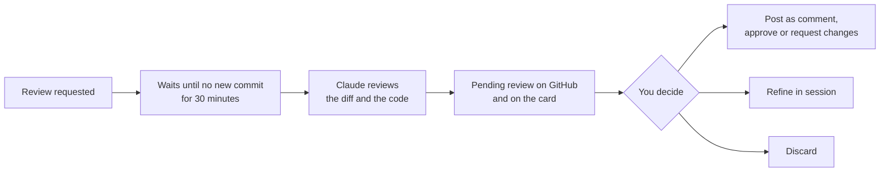

# Review Inbox

[](https://mods.aidojo.si/#SummerRiversound--review-inbox--review-inbox) [](https://github.com/hesreallyhim/awesome-claude-code)

**English** | [한국어](README.ko.md) | [日本語](README.ja.md) | [简体中文](README.zh-CN.md) | [繁體中文](README.zh-TW.md) | [Español](README.es.md) | [Português](README.pt-BR.md) | [Deutsch](README.de.md) | [Français](README.fr.md)

Your GitHub inbox inside [Claude Code](https://claude.com/claude-code): PRs waiting for your review, summarized in plain language, your own PRs and the reviews they get, and the issues that need you, without leaving the session.


## Features

| | |
| --- | --- |
| **Band above the prompt** | One line that counts only what needs you. Its colour shows how long the oldest review request has waited: yellow from 3 days, red from 14. |
| **Plain-language summaries** | Each PR waiting for you gets one sentence on what it does, why, what it touches, and a ⚠️ on risks such as a schema change. |
| **One-key hand-off to Claude** | `Review with Claude`, `Fix CI`, `Address comments` and other buttons put a ready-made request into your prompt. Nothing runs until you press Enter. |
| **Auto review** (optional) | Claude reviews PRs in the background and leaves each review as your pending review on GitHub, for you to post. |
| **Notifications and saved searches** | GitHub notifications no other tab shows, and searches you name, in their own tabs. |
| **Toasts** | A short notice when a review request, a review or a CI failure arrives while you work. |
| **Nine languages** | The interface, the summaries and the reviews. |

## Quick start

You need Claude Code 2.1.287 or later and the [GitHub CLI](https://cli.github.com/) logged in (`gh auth login`). Then, at the prompt of a Claude Code session:

```text
/plugin marketplace add https://github.com/SummerRiversound/review-inbox.git
/plugin install review-inbox@review-inbox
/review-inbox
```

The last line opens the drawer. Every option can stay at its default; see [Configuration](#configuration).

<details>
<summary>Requirements, update and uninstall</summary>

- Claude Code 2.1.287 or later, the first builds with mods (function-hook plugins). Tested on 2.1.292. Mods are in early access, and their API may change between releases.
- `gh` on your `PATH`, with access to the repositories you review. For GitHub Enterprise Server, set `GH_HOST` in the environment Claude Code starts in.

```sh
claude plugin marketplace update review-inbox
claude plugin update review-inbox@review-inbox
claude plugin uninstall review-inbox@review-inbox
```

An update applies after a restart. Uninstalling leaves the cache folder, `~/.claude/plugins/data/review-inbox`; delete it yourself to remove the cached lists and summaries. The [changelog](CHANGELOG.md) lists what each version changed.

</details>

## Usage

`/review-inbox` opens the drawer. Press `1` to `5` to switch tabs, type in the search field to look through every tab at once (titles, descriptions, summaries and your notes), and press a group's header to fold it.

| Tab | What it holds | Buttons |
| --- | --- | --- |
| **To review** | PRs waiting for your review, each with a summary, its size and how long it has waited. `re-requested` marks one that asks for you again, with what changed since your last review. | `Review with Claude`, `Hide` until a new commit |
| **My PRs** | Your open PRs in the order you have to act: changes requested, CI failing, conflict, waiting, approved, merge queue, draft. `New review` marks one reviewed since your last commit. | `Address comments`, `Fix CI`, `Resolve conflict`, `Merge` |
| **Assigned & mentioned** | Issues assigned to you, issues and PRs that mention you, and recent references to your work. | `Work on this` |
| **Saved searches** | `Involves me`, `Reviewed by me, still open`, `My open issues`, and your own searches. | Open on GitHub |
| **Notifications** | GitHub notifications no other tab shows, by reason, unread marked `●`. | `Done`, `Unsubscribe` |


On every card, `▸ Actions` holds `Note` (one line above the title), `Save`, `Snooze until tomorrow` or `next week`, and buttons that hand the card to Claude: `Summarize risks`, `Explain this diff`, `Draft approval comment`, `Draft reply to reviewer` and `Investigate CI failure`. Buttons that hand a card to Claude mark it `Added`; when you close the drawer, the requests go into your prompt, and nothing runs until you press Enter.

| My PRs | Assigned & mentioned |
| --- | --- |
|  |  |

<details>
<summary>More on cards, sessions and toasts</summary>

- **Next-step buttons.** On your PR stuck on you, or an issue assigned to you, the button names the folder Claude would work in: `this folder`, the last session's folder for that repository, or `no local clone`. Claude works in a new worktree and leaves that folder's branch alone. With no known folder, it asks where your clone is or offers `gh repo clone`.
- **Your review style.** A review request carries one line on how you usually review. Once a week the mod reads your own comments on up to 30 PRs you recently reviewed and asks Claude to describe your language, tone and what you look at first. Auto reviews posted under your name are left out.
- **In progress in a session.** Cards a session works on gather at the top of To review and My PRs, with the session's folder name: your PR when a session is on its branch, any card once a prompt in that session links to it. A session closed, or silent for 10 minutes, lets them go.
- **This repo first.** Cards from this session's repository come first, tagged `this repo`. `This repo N` and `All N` above the tabs narrow or widen the view; the band always counts everything.
- **Hidden and snoozed cards** come back when they have news: a new commit on a review request, a new state or review on your PR, new activity on an issue. `N hidden · show all` brings them back by hand.
- **Updated since you last looked.** A `●` before a card's repository marks one updated since you last closed the drawer.
- **Toasts** arrive for a new review request, a new review on your PR, your PR turning to changes requested, CI failing or conflicting, and a new assignment, mention or reference. A new session sums up what changed while you were away in one toast. Your PR turning approved with no CI running shows `Ready to merge` once.
- **Older sessions.** A session still on an older release is named under the drawer's title. `Reload them all` asks those sessions to run `/reload-plugins` once they are idle (0.13.0 or later).
- **Notifications** need gh's own sign-in or a classic token (`gh auth refresh -s notifications`). `Done` and `Unsubscribe` wait 10 seconds with `Undo`. Finished Actions runs show as `CI run` only while Actions notifications are on in your GitHub settings.


</details>

## Auto review

Turn it on with the `Auto review` button atop the To review tab, which says what it costs and asks first. Each PR that asks for your review directly is then reviewed by Claude in the background, and the review waits on its card as your **pending review**, which only you can see until you post it.



> **It uses noticeably more tokens:** tens of thousands a PR, more on `opus`. The card shows each review's cost, and `autoReviewDaily` caps how many start in a day (5 by default).

- **What it reviews.** Direct requests on PRs that are not drafts and not opened by bots. While it runs, the author sees only a 👀 reaction of yours.
- **What the reviewer gets.** The diff, the code at the head commit when the repository's folder is known, the PR's description, comments and checks, the risks its card flagged, and where your folders of the same owner's other repositories are. By default it can only read; `autoReviewTools` set to `all` gives it every tool of your session, so it can also run tests and commands.
- **Permissions with `all`.** The reviewer works under your session's permissions, in the background. A command your session would ask before running may not run while you are away, so run auto review in a session whose permission mode or allow rules let it run what a review needs, such as tests.
- **How it writes.** The verdict first, then findings graded blocker, major, minor and nit, each a bold conclusion with its reason below, placed on the lines they are about. Your learned style sets only the tone; `autoReviewInstructions` wins over the built-in rules.
- **On the card.** The suggested verdict, findings by severity and the cost, with `Post as comment`, `Post and approve`, `Post and request changes`, `Open on GitHub`, `Refine in session` and `Discard`.

<details>
<summary>Setup, sessions, new commits and failures</summary>

- **Setup.** `Settings ▸` beside the `Auto review` button opens each auto review setting under it: pick or type a value and it applies at once, as a change in `/config` does. The first time the button turns auto review on, they open by themselves. `Set up with Claude` there, or `/review-inbox auto-review-config` at any time, puts one line into your prompt; press Enter and Claude goes through the settings with you one at a time. Once pressed, the button alone turns auto review on and off for every session; `autoReview` in `/config` is only where it starts.
- **Which session runs it.** The session where you turned it on starts the reviews on this machine. `/review-inbox auto-review-here` moves them to another session, `/review-inbox auto-review-anywhere` lets any session start them. One review runs at a time across your sessions and machines; the 👀 tells other machines the PR is taken, and one left by a machine that stopped mid-review is taken over after an hour.
- **The run folder.** The mod writes the diff (and, for a re-request, the diff since your last review), the PR's description, conversation, line comments and checks into a run folder, and checks out the head commit there as a detached worktree when it knows the repository's folder. Both go when the review is stored.
- **Built-in rules.** The reviewer checks each finding against the code again before keeping it, turns what it cannot confirm into a question, approves when nothing blocks merging, and leaves out how it checked. With `autoReviewVerify` on, a second reviewer checks each finding before the review is stored.
- **Posting for you.** With `autoReviewPost` at `comment` or `verdict`, a review is posted as soon as it is stored and shows in an `Auto review done` group under the button; `Check all` clears it. If GitHub refuses, it stays your pending review.
- **New commits.** A running review stops when the PR gets a new commit, closes or stops asking for you. A rebase that changes no content moves your pending review, edits included, to the new commit; other new commits leave it with `Review again`.
- **Failures.** A reply that cannot be read is tried once more, then the card shows why with `Try again`. A reviewer that runs out of turns fails at once and says so; raise `autoReviewMaxTurns`.

</details>

## Configuration

Set options on the install screen, or later in `/config`. A change applies right away.

**General**

| Option | Default | What it does |
| --- | --- | --- |
| `scope` | empty | GitHub search qualifiers added to every search, such as `org:my-org`. Empty means all of GitHub. |
| `githubUser` | empty | The `gh` account to use when several are logged in. |
| `language` | `auto` | `auto`, or a code from [Language](#language). |
| `refreshMinutes` | `10` | Minutes between fetches: 5, 10, 15, 30 or 60. All sessions share one fetch. |
| `repoPaths` | empty | Where each repository lives on disk, for the next-step buttons and auto review. |
| `motion` | `auto` | `off` stops the band's count flash; `auto` follows Claude Code's reduced motion setting. |
| `directActions` | `off` | `on` adds buttons that write to GitHub themselves. See [Direct GitHub actions](#direct-github-actions). |

**Auto review**

| Option | Default | What it does |
| --- | --- | --- |
| `autoReview` | `off` | Where auto review starts; the `Auto review` button takes over once pressed. |
| `autoReviewPost` | `pending` | `pending` keeps it for you to post; `comment` or `verdict` posts it under your name without asking. |
| `autoReviewModel` | `sonnet` | `sonnet`, or `opus` for deeper reviews that cost more. |
| `autoReviewTools` | `read` | `read` lets the reviewer only read. `all` gives it every tool of your session under its permissions, as when you ask for a review yourself, but a PR's text can then try to steer the commands it runs. |
| `autoReviewVerify` | `off` | `on` has a second reviewer check each finding; about twice the tokens. |
| `autoReviewDaily` | `5` | Most reviews started a day: 3, 5, 10, 20 or `unlimited`. |
| `autoReviewSettleMinutes` | `30` | Minutes without a new commit before a review starts: 0, 10, 30, 60 or 120. |
| `autoReviewMaxTurns` | `40` | Turns the reviewer may take: 40, 60, 80 or 120. |
| `autoReviewSkills` | empty | Skills loaded into the reviewer, comma-separated, such as your review playbook. |
| `autoReviewInstructions` | empty | Your own words to the reviewer, such as what to check first. |
| `autoReviewSeverityNames` | empty | Four names for blocker to nit, comma-separated, such as `Blocker, Decision needed, Follow-up, nit`. |
| `autoReviewLarge` | `on` | `off` skips PRs over 50 files or 2,000 changed lines. |
| `autoReviewBacklog` | `on` | `off` skips requests made before auto review was on. |

<details>
<summary><code>scope</code> and <code>repoPaths</code> examples</summary>

`scope` takes anything GitHub's [issue and PR search](https://docs.github.com/en/search-github/searching-on-github/searching-issues-and-pull-requests) accepts. Repeated `org:`, `repo:` and `user:` match any of them, and a team review request counts as a request for you.

```text
org:my-org
org:my-org org:other-org
repo:owner/name repo:owner/other
org:my-org -repo:my-org/noisy-repo
```

`repoPaths` takes comma-separated `owner/repo=path` entries. `owner/*=path/*` covers every repository of an owner, an exact name wins over a wildcard, and `~` is your home folder. A folder named here wins over the session's own folder and the ones the mod remembers.

```text
my-org/*=~/code/*,my-org/legacy=~/old/legacy-app
```

</details>

## Customize

Add your own card buttons and saved searches in `actions.json` in the cache folder. `/review-inbox buttons` shows its path and anything it left out; `/review-inbox add-button` and `/review-inbox add-search` ask Claude to write one with you.

```json
{
  "buttons": [
    { "id": "test-plan", "name": "Test plan", "scope": "review", "prompt": "Write a test plan for {{.PrUrl}} in {{.RepoPath}}." },
    { "id": "draft-approval", "scope": "review", "hidden": true }
  ],
  "groups": [
    { "id": "team", "name": "Team PRs", "query": "org:acme is:open label:urgent", "scope": "prs", "countInBand": true },
    { "id": "reviewed-by-me", "hidden": true }
  ]
}
```

<details>
<summary>Fields</summary>

- **Buttons.** `scope` is `review`, `pr` or `issue`. A prompt can use `RepoName`, `RepoPath`, `PrNumber`, `PrUrl`, `PrTitle`, `Author`, `HeadRefName`, `BaseRefName`, `IssueNumber`, `IssueTitle` and `IssueUrl`, written `{{.Name}}` as in gh-dash. `PrTitle` and `Author` are someone else's text passed to Claude.
- **Saved searches.** `query` is GitHub search syntax; `scope` (`prs` or `issues`) adds `is:pr` or `is:issue`, and `sort:updated-desc` is added unless the query sorts. The `scope` option does not narrow them. `"countInBand": true` adds the count to the band. Only the first 15 run, each showing its 20 newest matches.
- **Both.** A built-in id replaces that entry, `"hidden": true` removes it, and an entry with a missing field or an unknown scope or variable is left out with a warning at the bottom of the drawer.

</details>

### Direct GitHub actions

With `directActions` on, cards also get buttons that write to GitHub as your `gh` account: `Approve` on a review request, `Ready for review` and `Update branch` on your PR, `Rerun failed CI`, and `Assign me` on an issue that mentions you.

- Others see these and they cannot be taken back, so the first press shows what will be sent and as whom; `Confirm` (or `y`) sends it, and `Cancel` or ten seconds brings the buttons back. A confirm within 300 ms of the first press is ignored.
- An approval names the commit you looked at and is not sent if new commits arrived. `Update branch` merges and never rebases. `Assign me` is sent at once with `Undo`.
- Nothing merges directly: `Merge` puts a request into your prompt for Claude to check the repository's merge methods and run `gh pr merge`.

## Language

Everything the mod shows or writes uses one language: `en`, `ko`, `ja`, `zh-CN`, `zh-TW`, `es`, `pt-BR`, `de` or `fr`.

`auto` (the default) follows Claude Code's own `language` setting, then the system locale (`LC_ALL`, `LC_MESSAGES`, `LANG`), then English. Switching writes each summary once more in the new language. Languages other than English and Korean were translated with Claude; corrections are welcome in [`hooks/locales/`](hooks/locales/).

## Privacy and permissions

The mod reaches GitHub only through your own `gh`, sends PR text to Claude for summaries, and writes only to its own cache folder. Auto review, when on, also starts a subagent and stores reviews on GitHub.

[](https://mods.aidojo.si/#SummerRiversound--review-inbox--review-inbox)

<details>
<summary>Everything it reads and runs</summary>

This matches what `claude plugin validate .` lists for the mod.

- **Runs `gh`**: `gh api graphql` for the lists and, once a week, for your recent review comments; `gh api repos/<owner>/<repo>/compare/<from>...<to>` for a re-requested PR, and `gh auth token -u <githubUser>` when `githubUser` is set. For the Notifications tab it runs `gh api notifications`, and `gh api -X DELETE notifications/threads/<id>` (with `/subscription` first for Unsubscribe) when you press `Done` or `Unsubscribe`. With `directActions` on, a button you press runs `gh api user` for your account name and `gh api repos/<owner>/<repo>/pulls/<n>` to read the head commit, then one of `gh api -X POST …/pulls/<n>/reviews` (`event=APPROVE`, `commit_id`), `gh pr ready`, `gh api -X PUT …/pulls/<n>/update-branch`, `gh api …/actions/runs?head_sha=<sha>&status=failure` with `gh api -X POST …/actions/runs/<id>/rerun-failed-jobs`, or `gh api -X POST`/`-X DELETE …/issues/<n>/assignees`. With `autoReview` on, it runs `gh api …/pulls/<n>/reviews` and `…/pulls/<n>/files` before and after each review, `gh pr diff`, `gh pr view` for the description and conversation, `gh api …/pulls/<n>/comments` and `gh api …/commits/<sha>/check-runs`, and `gh api -X POST …/pulls/<n>/reviews` with the review on its stdin to store it as your pending review; carrying it to a new commit reads `…/reviews/<id>` and `…/reviews/<id>/comments` and runs `gh api -X DELETE …/reviews/<id>` before creating it again. Around each review it adds and removes the 👀 with `gh api -i -X POST …/issues/<n>/reactions` (`content=eyes`) and `gh api -X DELETE …/issues/<n>/reactions/<id>`. The card's buttons run `gh api -X POST …/reviews/<id>/events` (`event=COMMENT`, `APPROVE` or `REQUEST_CHANGES`) or `gh api -X DELETE …/reviews/<id>`, after reading the head commit. With `autoReviewPost` at `comment` or `verdict`, it runs the same call on the review it stored, right after storing it. The mod makes no other network calls of its own.
- **Runs `git`** in the session's folder every 30 seconds: `git branch --show-current` and `git remote -v`, to find a session on your PR's branch, and `git rev-parse --path-format=absolute --git-common-dir`, to remember the main folder of that repository. With `autoReview` on and the repository's folder known, it runs `git fetch origin pull/<n>/head` and `git worktree add --detach` there for each review, and `git worktree remove --force` when the review ends.
- **Asks Claude** (the `sonnet` model) for each summary, sending a PR's repository name, title, description (first 12,000 characters), changed file paths (up to 80) and size; for a re-requested PR, also the first line of each commit message and up to 60 file paths since your last review. Each PR is summarized once per head commit and language; a summary that fails is tried at most three times per commit. Once a week it also sends your own review comments on up to 30 PRs you recently reviewed, each cut to 500 characters, at most 60 of them and 12,000 characters in all, to describe your review style; with fewer than five, nothing is sent. This counts against your Claude Code usage.
- **Starts a subagent** only with `autoReview` on: one `auto-reviewer` at a time, on `autoReviewModel`, and with `autoReviewVerify` on a second one that checks its findings, with read-only tools (every tool of your session with `autoReviewTools` on `all`), your CLAUDE.md, hooks and `autoReviewSkills`. It counts against your Claude Code usage. Its agent type is kept out of the list your own Claude chooses from. Stopping it uses `TaskStop`.
- **Writes files** only in its cache folder, `~/.claude/plugins/data/review-inbox` (`CLAUDE_CONFIG_DIR` takes the place of `~/.claude` when set). `inbox-<hash>-f<n>.json` holds the lists and summaries; `hidden-<hash>.json` holds hidden PRs; `notes-<hash>.json` holds your notes and snoozes, one file per account and scope whatever the language; `sessions.json` holds each live session's folder name, release of the mod, branch, GitHub remotes and the PR links its prompts held, for every account; `repos.json` holds the main folder of each GitHub repository a session has run in, for the next-step buttons; `style-<hash>.json` holds the description of your review style. `autoreview-<hash>.json` holds each PR's place in auto review and its last result, and `runs/` the run folders, removed with `rm -rf` when a review ends. Each file is written beside itself and moved into place with `mv`, so a session never reads half of one; where there is no `mv`, as on Windows, it is written in place. It reads `actions.json` there if you made one, and never writes it.
- **Reads environment variables**: `CLAUDE_CONFIG_DIR`, `HOME` and `USERPROFILE` to find that folder; `GH_REPO` to know this session's repository, as `gh` does; `LC_ALL`, `LC_MESSAGES` and `LANG` only when `language` is `auto`. It sets none.
- **Reads Claude Code settings**: the `language` key only when `language` is `auto`, and the `prefersReducedMotion` key only when `motion` is `auto`.
- **Reads and fills your prompt** only around the drawer: it reads the draft when the drawer opens, to mark the PRs it already asks for, and when the drawer closes it adds the requests for the PRs you added, on new lines after the draft.
- **Changes its own settings** only when you ask: a value you pick under `Settings ▸` is written with `$.config.set`, as `/config` writes it. It adds two tools Claude can call, `auto_review_settings` to read the auto review settings and `set_auto_review_setting` to change one, which refuses a setting or value the list does not have.

</details>

<details>
<summary>How it works and limits</summary>

All open sessions share one fetch: every 30 seconds each session reads a shared cache file, and only one that finds it older than `refreshMinutes` and wins a short claim asks GitHub, so ten sessions make one request. A claim not renewed for 3 minutes is taken over, a failed fetch keeps the last good lists and retries after a minute, and `↻` in the drawer fetches at once. One GraphQL search fills To review, and one more request with three searches fills My PRs and Assigned & mentioned; references come from cross-reference events on items touched in the last 60 days.

- At most 100 PRs waiting for your review, and up to 100 items in each other list; a longer list reads `100+`. Lists are read 25 at a time, and a page GitHub times out on is asked again at half the size.
- A reference to an item you have not touched in 60 days is missed.
- `New review` clears on any new commit, including one from GitHub's "Update branch" button or a bot. After a force-push that rewrote the commit you reviewed, a re-request shows no "since my last review" line.
- Your review style is learned from `reviewed-by:@me -author:@me` within `scope`; comments outside a review are not part of it.
- `Rerun failed CI` reruns GitHub Actions only. Approving several PRs at once, or with a comment, is not offered.
- Auto review runs tests or builds only with `autoReviewTools` on `all`. A carried review moves only when every file's patch is the same. A review held back by `autoReviewDaily` also holds back a carry. On Windows without WSL, run folders stay in the cache folder.

</details>

## Troubleshooting

| Symptom | What to do |
| --- | --- |
| The drawer shows a `gh` error | Run `gh auth status`; with several accounts, set `githubUser`. The mod retries every minute. |
| The band does not appear | It shows only when something needs you. |
| The language is not the one you expected | Set `language` to a code instead of `auto`. |
| Something else | Start with `claude --debug`; this mod's lines begin with `review-inbox:`. |

## Development

```sh
claude plugin validate .
claude plugin test .
claude --plugin-dir .
```

Neither `validate` nor `test` needs a login, and CI runs both on the tested Claude Code build. `tsconfig.json` extends `.claude-plugin/types/tsconfig.json`, which Claude Code writes the first time it loads the mod from this folder, so run `claude --plugin-dir .` once before `tsc -p .`.

## Support

If Review Inbox saves you time, you can [buy me a coffee](https://ko-fi.com/riversound). Thank you!

<a href="https://ko-fi.com/riversound"></a>

## License

[MIT](LICENSE)
